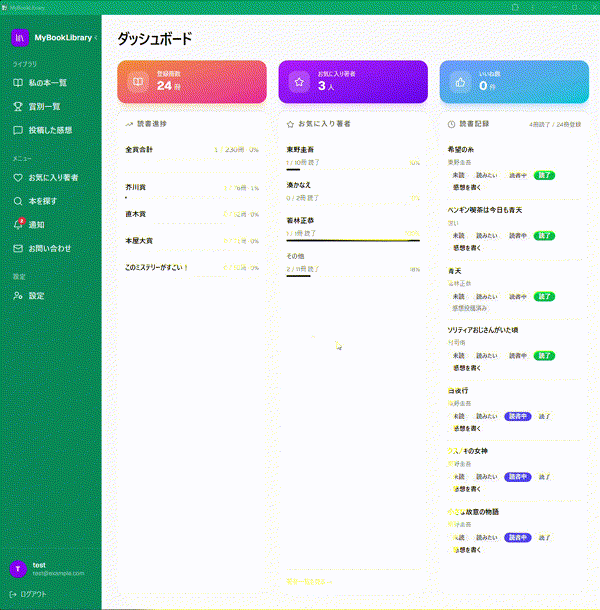
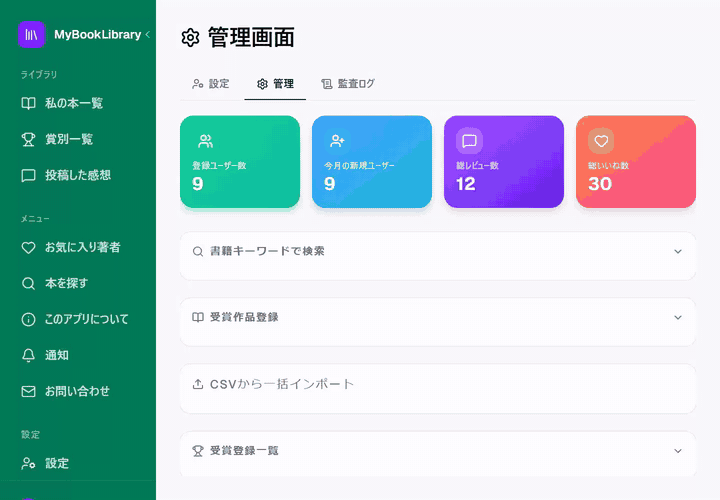
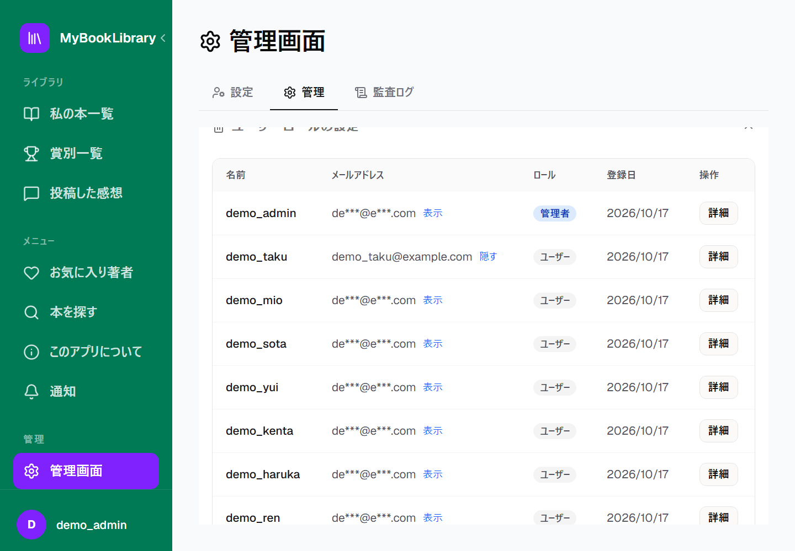
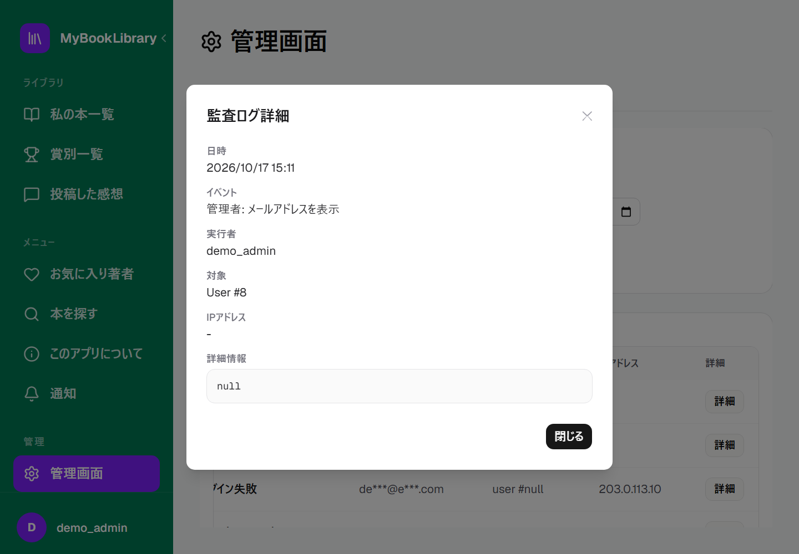

# MyBookLibrary

## ライブデモ

**[https://mybooklibrary-demo.nyproducts.workers.dev](https://mybooklibrary-demo.nyproducts.workers.dev)**

### ライブデモの使い方と注意事項

- **通常利用との違い**：通常は各自のアカウントで読書状況を管理します。デモでは他の試用者と同じアカウント・本棚を使います。デモ用の記録は毎日午前3時（日本時間）に初期化される設定で、新規登録や新刊の定期チェックなどは利用できません。
- ログイン画面に表示されるパスワードとデモ用のメールアドレス（`demo_sakura@example.com`）でログインできます。
- 実在の個人情報は入力しないでください。

<details>
<summary>操作手順と利用制限を詳しく読む</summary>

次のデモ用アカウントでログインして、読書状況などを試せます。**ほかの試用者も同じアカウントを使います。自分だけの本棚ではありません。**

| 項目 | 内容 |
| --- | --- |
| メールアドレス | `demo_sakura@example.com` |
| パスワード | ログイン画面に表示されています |

> **ご利用上の注意**
>
> - デモ用のユーザー・読書記録・レビューは架空のサンプルです。文学賞・本・著者の情報には実在のデータを使っています。デモ用の記録は毎日午前3時（日本時間）に初期化する構成です。試用中の変更を保存先として当てにしないでください。
> - **個人情報・実在のメールアドレスを入力しないでください。**
> - デモ用のため、新規登録・パスワード変更・退会・問い合わせの送信・Google ログインなど、一部の機能は制限されています。
> - ログイン状態が15分間更新されないと、次に操作したときに再ログインが必要になります。
> - デモでは新刊の定期チェックを実行しません。デモ用アカウントで「通知」を開くと、サンプル通知を確認できます。
> - 管理者機能は公開していません。下記の「[デモ](#デモ)」の GIF・スクリーンショットをご覧ください。

構成と保護の方針は [デモ環境の方針と構成](docs/demo-environment.md) を参照してください。

</details>

文学賞の受賞・ノミネート作品の読書進捗管理と、お気に入り著者の管理を行う Web アプリケーション。

## 制作背景

家族から、文学賞の受賞・ノミネート作品を確認しながら読書状況を管理できるアプリが見つからないと聞いたことをきっかけに制作しました。

普段から図書館を利用しているため、蔵書状況を確認し、外部の予約ページへ移動できる機能も加えました。また、好きな著者の新刊を知れたら面白いという話から、お気に入り著者の新刊情報をアプリ内で確認できる機能へと発想を広げました。

## アプリ概要

[紹介動画付きのアプリ概要](https://yamamotonaoki3.github.io/MyBookLibrary/)で、主な機能と実際の操作画面を確認できます。

## 主な機能

| 機能 | 内容 |
| --- | --- |
| **読書ステータス管理** | 本の詳細や一覧で「読みたい」「読書中」「読了」を選ぶと、自分の記録を保存し、「私の本一覧」で確認できます。「未読」を選ぶと自分の読書記録から外れますが、作品情報や投稿済みの感想は削除されません。 |
| **文学賞作品一覧** | 直木賞・芥川賞・本屋大賞・このミステリーがすごい！の受賞・ノミネート作品を一覧表示し、読了率をプログレスバーで確認 |
| **本の検索** | 楽天ブックス API 連携。「バーコードで登録」では、カメラで ISBN を読み取り、該当する本を「読書中」として登録できます。 |
| **お気に入り著者管理** | 著者をお気に入りに追加し、著者ごとに新刊通知をオン・オフできます。著者のおすすめも確認できます。 |
| **レビュー・いいね・通報** | ネタバレフラグ付きで感想を投稿し、他ユーザーのレビューにいいね・通報できる |
| **フォロー** | ユーザー同士をフォローし、フォロー一覧・おすすめフォロー候補を確認できる |
| **図書館の貸出状況** | 図書館を最大5館登録し、本の一覧や詳細から「貸出チェック」を開くと、登録した図書館の貸出状況を版・図書館ごとに確認できます。本棚への登録は不要です。「予約する」が表示される場合は図書館のサイトが別タブで開き、予約はそちらで行います。 |
| **通知** | 新刊・いいね・フォローなどは、ログイン後の「通知」画面に表示されます。PWA をインストールし、端末が対応していれば、アプリアイコンにも未読件数が表示されます。 |
| **認証** | メール＋パスワード / Google OAuth。ログイン失敗 10 回で 15 分ロック。新規登録時に任意で合言葉を設定でき、合言葉によるパスワードリセットに対応 |
| **PWA** | ホーム画面へのインストール・スタンドアロン起動対応 |
| **お問い合わせ** | カテゴリ（バグ報告・機能要望など）を選択してフォームから問い合わせを送信できる |
| **設定** | アカウント情報（名前・メール・ロール）の確認・合言葉設定・アカウント削除 |
| **管理者機能** | 受賞登録・CSV 一括インポート／エクスポート・手動書籍登録／マージ・通報レビュー削除・ユーザー管理・お問い合わせ管理・監査ログ閲覧・統計ダッシュボード。ほかのユーザーのメールアドレスは既定でマスク表示で、「表示」ボタンで確認したときは監査ログに記録される |

## 作品データの登録と新刊情報の更新

- **文学賞の候補作**：対象ページを一つずつ手動で開き、HTML として保存しました。保存したページ内の JSON から必要な項目を取り出して CSV を作り、アプリに取り込みました。候補作を集めるために、文学賞のサイトを自動巡回する仕組みは使っていません。
- **お気に入り著者の新刊**：新刊通知をオンにした著者について楽天ブックス API を定期的に確認し、対象の本が見つかったときにアプリ内の「通知」に表示します。候補作を取り込む手順とは別です。

## デモ

以下の GIF・画像は操作の一例です。公開デモで操作できる範囲は「[ライブデモの使い方と注意事項](#ライブデモの使い方と注意事項)」をご覧ください。

### ダッシュボード

ログイン後のダッシュボード画面です。


### バーコードスキャンで本を検索

下のGIFは、カメラで本のバーコードを読み取ってISBNで検索する操作例です。現在の「バーコードで登録」では、該当する本が見つかると「読書中」として本棚に登録します。



### 管理者機能

管理者の画面（ユーザー管理 → 手動登録本の管理 → 通報されたレビュー → お問い合わせ → 監査ログ）です。ローカル環境で、架空のデータを使って撮影しました。メールアドレスは既定でマスクされ、「表示」ボタンで全体を確認すると、監査ログに記録されます。



| ユーザー管理（「表示」でメールを確認） | 監査ログ（表示の記録） |
| --- | --- |
|  |  |

動画（[mp4](docs/images/demo/admin-demo.mp4)・[webm](docs/images/demo/admin-demo.webm)）と、各画面のスクリーンショット（`docs/images/demo/`）もあります。

## 技術スタック

| 役割 | 技術 |
| --- | --- |
| フロントエンド | Next.js 16 (React 19) + TypeScript |
| バックエンド | Next.js API Routes |
| データベース | Cloudflare D1（SQLite。本番・ステージング・デモ）／ MySQL 8.4（ローカル開発） |
| ORM | Prisma 7 |
| 認証 | Auth.js (NextAuth.js) v5 ベータ版（`next-auth@5.0.0-beta.x`。メール＋パスワード・Google OAuth） |
| バリデーション | Zod v4 |
| スタイリング | Tailwind CSS v4 + shadcn/ui |
| テスト | Jest + ts-jest、Playwright（E2E） |
| コンテナ | Docker（開発時の MySQL 用） |
| 外部 API | 楽天ブックス API・国立国会図書館 API（NDL）・カーリル API |
| PWA | @ducanh2912/next-pwa |
| デプロイ | Cloudflare Workers（OpenNext）+ D1。`main` → ステージング、`production` → 本番、`demo` → デモを、Workers Builds で自動デプロイ（[手順](docs/cloudflare-deploy.md)） |

各パッケージの正確なバージョンは、[`app/package.json`](app/package.json) と [`app/package-lock.json`](app/package-lock.json) を参照してください。アプリ自体のバージョン（`/api/version` の `name`）の付け方は、[バージョンの付け方と基準](docs/versioning.md) にあります。

AWS（EC2 + RDS + CloudFront。Terraform 管理）は、現在すべて停止中です。いつでも再開できるよう、定義と手順だけ残しています（[AWS デプロイガイド](docs/aws/aws-deploy-guide.md)）。

E2E テストには Playwright を使用（詳細は下記「テスト」参照）。

## 開発環境の起動

ローカル開発は、Docker の MySQL を使います。Cloudflare Workers での動作確認（ビルド・プレビュー・D1）は [Cloudflare へのデプロイ](docs/cloudflare-deploy.md) を参照してください。

```bash
# 0. Docker Compose 用の環境変数を設定（初回のみ）
cp .env.example .env
# .env を編集して DB_MYSQL_ROOT_PASSWORD などを設定（推測されにくい値にする）

# 1. MySQL を起動
docker compose up -d

# 2. 依存パッケージをインストール（初回のみ）
cd app
npm install

# 3. 環境変数を設定（初回のみ）
cp .env.local.example .env.local
# .env.local を編集して DATABASE_URL などを設定

# 4. データベースのマイグレーション（初回のみ）
npx prisma migrate dev

# 5. 開発サーバーを起動
npm run dev
```

ブラウザで http://localhost:3000 を開く。

### ローカルテスト用DBの上書き設定（任意）

テスト用DBのイメージを固定し、ポートをローカルホストだけに公開する例です。ベース設定のテスト用DBを変更するもので、新しいDBを追加する設定ではありません。既存の `docker-compose.override.yml` がある場合は上書きせず、そのまま利用してください。

```powershell
if (Test-Path -LiteralPath docker-compose.override.yml) {
    throw '既存の docker-compose.override.yml があるため、上書きしません。'
} else {
    Copy-Item -LiteralPath docker-compose.override.yml.example -Destination docker-compose.override.yml
}
```

この例はテスト用DBを `127.0.0.1:3307` に公開します。ベースの Compose 設定にあるサービスのボリューム設定を引き継ぐため、DBデータを作り直したり移行したりする設定ではありません。新しい環境で例をコピーした場合は、適用内容を次のコマンドで確認できます。

```powershell
docker compose -f docker-compose.yml -f docker-compose.override.yml.example config --quiet
```

確認ではサンプルを直接指定し、ローカルのoverrideの内容を読み込んだり表示したりしません。

## ディレクトリ構成

```
MyBookLibrary/
├── app/                      # Next.js アプリケーション本体
│   ├── prisma/               # Prisma スキーマ・マイグレーション（MySQL 用と、D1 用の prisma/d1）
│   ├── public/               # 静的ファイル・PWA アイコン
│   ├── wrangler.jsonc        # Cloudflare Workers / D1 の設定
│   └── src/
│       ├── app/              # App Router（ページ・API Routes）
│       │   ├── api/          # API エンドポイント
│       │   ├── _components/  # 共通コンポーネント
│       │   └── (auth)/       # 認証ページ（login・register・forgot-password）
│       ├── lib/              # サーバーサイドのユースケース・ユーティリティ
│       ├── repositories/     # Prisma によるデータアクセス
│       ├── types/            # TypeScript 型定義
│       └── __tests__/        # Jest テスト
├── docs/                     # ドキュメント（要件定義・ER図・手順書など）
├── terraform/                # AWS インフラ定義（Terraform。停止中）
└── docker-compose.yml        # 開発用 MySQL コンテナ
```

## ドキュメント

一覧は [ドキュメント索引](docs/README.md) を参照する（現役の文書・停止中の AWS 構成・作業が完了した記録に分けている）。主なもの:

- [要件定義書](docs/requirements.md)・[機能別定義書](docs/features/)・[API 仕様書](docs/api-spec.md)・[ER 図](docs/er-diagram.md)
- [画面遷移図](docs/screen-transition.md)・[ワイヤーフレーム](docs/wireframes.md)
- [アーキテクチャ概要](docs/architecture.md)・[運用手順書](docs/operations.md)
- [Cloudflare へのデプロイ](docs/cloudflare-deploy.md)・[本番切り替え手順書](docs/d1-cutover-runbook.md)・[デモ環境の方針と構成](docs/demo-environment.md)
- [テスト計画表](docs/test-plan.md)・[テスト依存関係マップ](docs/test-dependency-map.md)
- [AWS 構成（停止中）](docs/aws/README.md)
- [移行計画（アーカイブ）](docs/archive/cloudflare-d1-migration-plan.md)

## テスト

Jest + ts-jest によるブラックボックス（API結合テスト）・ホワイトボックス（`src/lib` の単体テスト）の両方式でテストしている。対象範囲と進捗は [テスト計画表](docs/test-plan.md) を参照。

```bash
cd app
npm test
```

### 実DB統合テスト

`docker-compose.yml` の `db-test` サービス（開発用DBとは別、ポート3307）に対して実行する。初回のみ `.env.example` / `app/.env.test.example` を参考に `.env` / `app/.env.test` を作成する。

```bash
docker compose up -d db-test
cd app
npm run test:integration
```

### E2E（Playwright）

ローカルでは初回のみブラウザのインストールが必要（CIでは自動インストールされる）。

```bash
cd app
npx playwright install chromium
npm run test:e2e
```

`app/.env.test` の接続情報を使い、DBは自動でリセット・シードされる。外部API（楽天・NDL・カーリル）はローカルのスタブサーバーに向くため、実際の外部通信は発生しない（詳細は [テスト依存関係マップ](docs/test-dependency-map.md) を参照）。

## シークレットの取り扱い

環境変数の実値はリポジトリに置かない。配置先と Gitleaks / pre-commit の導入手順は [環境変数とシークレットの管理](docs/secrets-management.md) を参照する。
