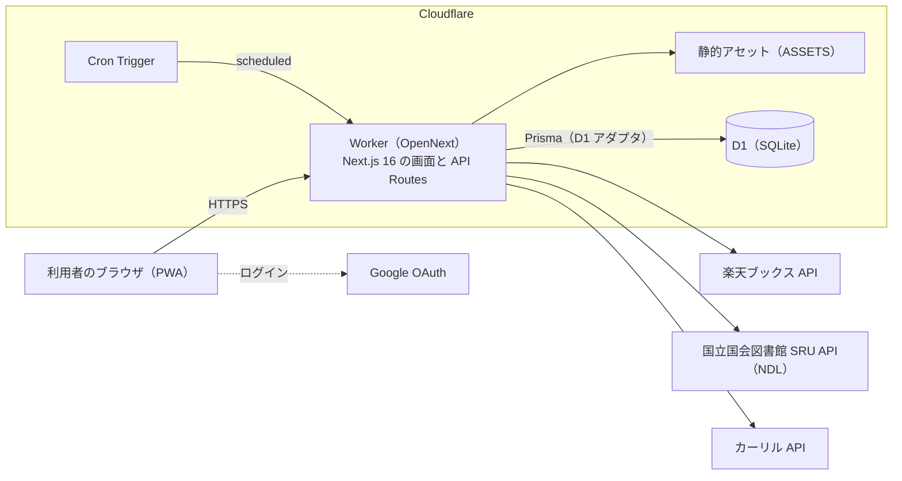

# アーキテクチャ概要

MyBookLibrary の全体の構成を、1 枚で見られるようにまとめる。細かい手順は、各文書へのリンクで示す。設定の唯一の定義元は `app/wrangler.jsonc`。

## 構成図



- アプリは **Next.js 16**（画面と API Routes が同じプロジェクト）。OpenNext で Cloudflare Workers 向けにビルドし、**1 つの Worker** として動かす。
- データは **Cloudflare D1**（SQLite）。ORM は Prisma 6（D1 アダプタ。wasm 版のクライアント）。
- 定期実行は **Cron Trigger**。Worker の `scheduled` ハンドラが、Worker 自身の API を、Bearer 認証で内部呼び出しする。
- 外部 API は、サーバー（Worker）から呼ぶ。利用者のブラウザが直接呼ぶのは、Google のログイン画面だけ。
- **AWS（EC2・RDS・CloudFront）は、リソースを削除済み**。構成は [aws/README.md](aws/README.md) に残している。

## 環境

同じコードを、3 つの環境に、別々の Worker・D1 で公開する。

| 環境 | Worker 名 | D1 | デプロイ元のブランチ | Cron | 備考 |
| --- | --- | --- | --- | --- | --- |
| 本番 | `mybooklibrary` | `mybooklibrary-db` | `production` | 毎日 UTC 00:00（JST 09:00）: 新刊チェック | 利用者向け。実データ |
| ステージング | `mybooklibrary-staging` | `mybooklibrary-staging-db` | `main` | なし（本番との二重通知を防ぐ） | 確認用。架空データ |
| デモ | `mybooklibrary-demo` | `mybooklibrary-demo-db` | `demo` | 毎日 UTC 18:00（JST 03:00）: デモの初期化 | `DEMO_MODE=true`。公開。架空データ。[方針](demo-environment.md) |

- 公開 URL は `https://<Worker 名>.nyproducts.workers.dev`。
- 環境ごとに、secret（`AUTH_SECRET`・`CRON_SECRET` など）は**別の値**を登録する。値は、リポジトリ・Issue・PR・チャットに書かない（[環境変数とシークレットの管理](secrets-management.md)）。

## リクエストの流れ

1. ブラウザ → Worker。静的ファイル（`/_next/static` など）は、アセットから返す。
2. 画面と API は、まず `src/proxy.ts`（Auth.js の `auth`。判定は `src/auth.config.ts`）を通り、未ログインなら、ログイン画面へ送る。**未ログインでも通すのは**、`/login`・`/register`・`/forgot-password`・`/api/auth/*`・`/api/cron/*`・`/api/version`・`/manifest.json`・`/icons/*`。`/api/cron/*` は、ログインのセッションではなく、Route Handler が **Bearer トークン（`CRON_SECRET`）**で認証する。`api/auth/*` と静的ファイルは、proxy 自体を通さない。
3. ページ・Route Handler が、サービス・リポジトリ経由で D1 を読み書きし、必要なら外部 API（楽天・NDL・カーリル）を呼ぶ。
4. 管理者の API は、`requireAdminSession` で、JWT のロールと DB の最新のロールの両方を確認する。デモ環境では、管理者の API をすべて 403 にする。

## コードの層

画面・HTTP・業務ロジック・データアクセスを、同じファイルに混在させない（詳細は [`CLAUDE.md`](../CLAUDE.md) の「責務分離のルール」）。

| 層 | 場所 | 役割 |
| --- | --- | --- |
| Presentation | `app/src/app/**/page.tsx`・表示コンポーネント | 表示・画面イベント |
| Controller | `app/src/app/api/**/route.ts` | HTTP の入出力・認証・認可・入力検証 |
| Service / Query | `app/src/lib/` | 業務ルール・ユースケース |
| Repository | `app/src/repositories/` | Prisma によるデータアクセス |
| Infrastructure | `app/src/lib/prisma.ts` ほか | DB・外部 API への接続 |

## データ

- **D1 のスキーマ**は、MySQL 版の `prisma/schema.prisma` から生成する（`npm run schema:d1:check` が、CI で、ずれを検出する）。マイグレーションは `app/prisma/d1/migrations`。**デプロイのたびに、リモートの D1 へ適用**してから、Worker を公開する（`scripts/deploy-worker.mjs`）。
- **Prisma のクライアントは、リクエストごとに作る**（D1 のバインディングから。接続処理の待ちを、リクエスト間で共有しない。#734）。
- **D1 の制限**: 1 クエリのバインド変数は **100 個まで**。件数に比例する読み込み（`IN`・1 対多の `include`・`createMany`）は、`src/lib/chunk.ts` で分ける（[lessons-learned](lessons-learned.md)）。
- **トランザクション**: D1 のアダプタでは、`$transaction` が実質使えない。複数の書き込みを原子的に行うときは、D1 の `batch` を使う（`src/lib/atomically.ts`）。
- **ローカル開発**は、Docker の MySQL 8.4。D1 を使う確認は、`wrangler dev --local` と、ローカルの D1（miniflare）。

## 認証とセッション

- Auth.js (NextAuth.js) v5、JWT ストラテジー。メール＋パスワードと、Google OAuth。
- 有効期間は、最後のセッション更新から: 保持なし 8 時間、保持あり／Google 30 日、デモ 15 分（[認証の定義書](features/auth.md)）。
- 管理者画面で、ほかのユーザーのメールアドレスは、既定でマスクする（[管理者機能の定義書](features/admin.md)）。

## 定期実行（Cron）

- 本番: 新刊チェック（`GET /api/cron/check-new-books`）。お気に入り著者の新刊を、楽天ブックス API で探し、通知を作る。重複通知は作らない（冪等）。
- デモ: 新刊チェックの代わりに、デモのデータの初期化（`GET /api/cron/reset-demo`）。
- ステージング: なし。手動で確認する。
- 詳細は [新刊チェック（Cron）の定義書](features/cron.md)。

## 外部サービス

| サービス | 用途 | 注意 |
| --- | --- | --- |
| 楽天ブックス API | 本の検索・書影・新刊チェック | 「許可された Web サイト」に、Worker のドメインの登録が必要。許可外は 403。403 のとき、アプリは NDL へ切り替わる |
| 国立国会図書館 SRU API（NDL） | 絶版・旧版などの検索、楽天が使えないときの代替 | — |
| カーリル API | 近隣図書館の蔵書確認 | `CALIL_API_KEY` が必要 |
| Google OAuth | Google ログイン | 環境ごとに、リダイレクト URI の登録が必要。デモでは使わない |

## デプロイの流れ

```
PR → GitHub Actions（テスト・型・Lint・ドキュメントのリンク確認・Worker のビルド確認）→ main にマージ
  → Workers Builds が main をステージングへ自動デプロイ → ステージングで確認
  → main を production ブランチへ反映 → 本番へ自動デプロイ
  → （デモを更新するときだけ）main を demo ブランチへ反映
```

- テストは GitHub Actions（PR のマージ条件）。ビルドとデプロイは Workers Builds。
- デプロイは、リモートの D1 へマイグレーションを適用 → `wrangler deploy`（コミットをバージョンのタグに付ける。`/api/version` で確認できる）。
- 手順・ロールバックは [Cloudflare へのデプロイ](cloudflare-deploy.md)。日々の運用は [運用手順書](operations.md)。

## 関連文書

- [ドキュメント索引](README.md)
- [要件定義書](requirements.md)
- [Cloudflare へのデプロイ](cloudflare-deploy.md)・[運用手順書](operations.md)
- [デモ環境の方針と構成](demo-environment.md)
- [移行計画（アーカイブ）](archive/cloudflare-d1-migration-plan.md)
