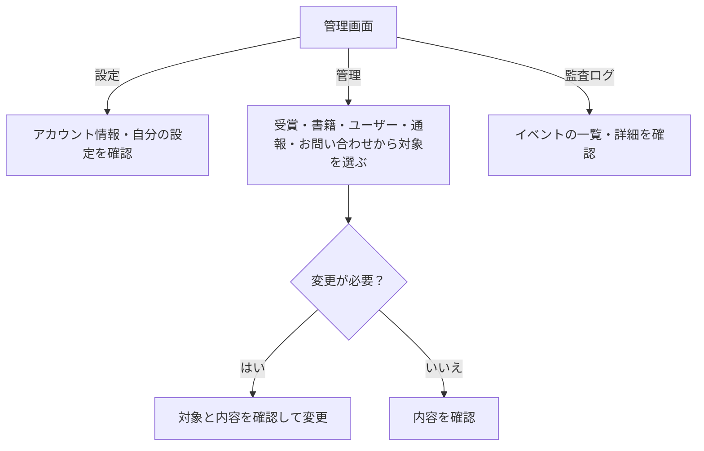

# 管理者機能 機能定義書

← [要件定義書に戻る](../requirements.md)

## 使い方

1. 管理者でログインし、「管理画面」を開きます。
2. 「設定」タブでは自分のアカウント情報・フォロー・近隣図書館・合言葉を確認します。「管理」タブでは受賞登録、手動登録本、ユーザー、通報、お問い合わせを管理します。
3. 「監査ログ」タブでは重要な操作の記録を確認します。

## 実画面

隔離したローカル環境の架空データで、ユーザーロールの一覧と監査ログのフィルターを確認する例です。ロール変更・削除・メールアドレスの表示は収録範囲外です。

## 操作フローチャート

## 注意点

- 管理操作は対象と影響を確認してから行います。削除など、元に戻せない操作があります。
- 他のユーザーのメールアドレスはマスクされます。必要なときに「表示」を押すと、一時的に全体が表示され、監査ログに記録されます。
- デモでは管理APIを利用できません。

## 機能仕様

### 管理者

#### できること

- 受賞・ノミネートを登録・編集・削除し、CSV の一括インポートやエクスポートを行う。手動登録本の編集・削除や重複書籍の統合を行う。
- ユーザーのロール変更やパスワードの強制リセット、通報されたレビューとお問い合わせの対応を行う。
- ユーザーやレビューなどの統計と、重要な操作の監査ログを確認する。

#### できないこと・条件

- 自分や他の管理者は削除できない。自分のロールは変更できず、管理者は最大5人。最後の管理者は降格できない。

### 一般ユーザー・デモを試す人

#### できないこと・条件

- 管理者パネルや管理者向けの操作は利用できない。

## 設計判断・理由

管理操作は管理者に限り、削除やロール変更といった重要な操作の経緯を監査ログで追えるようにしています。メールアドレスの表示操作も記録します。

技術詳細（保存・処理条件・関連画面／API）

### 動作条件と処理の仕組み

#### 受賞・書籍管理

- 書籍タイトルを入力して楽天ブックス API から書籍情報を自動取得し、受賞／ノミネート登録ができる
- 書籍検索に国立国会図書館（NDL）SRU API モードを追加。絶版・旧版など楽天に存在しない書籍の ISBN を検索できる
- 管理者画面から直接書籍の ISBN を編集できる
- CSV ファイルで受賞・ノミネートデータを一括インポートできる
- 受賞登録一覧は賞タブ＋年度セレクトで絞り込み可能。賞タブ切り替え時に年度は自動リセットされ、絞り込み後の件数を表示する
- 受賞データを CSV でエクスポートできる

#### 手動登録書籍の管理・マージ

- 楽天ブックス API / NDL に存在しない書籍は、一般ユーザーが本の検索画面（`/books/search`）から手動で登録できる（詳細は [本の一覧・検索 機能定義書](./book-search.md) を参照）
- 重複して登録された書籍（同一書籍が別レコードとして存在する場合）をマージし、関連する読書ステータス・レビュー・受賞登録を統合できる

#### 監査ログ

- 管理者操作（ユーザー削除・受賞登録の編集など）や合言葉の更新といった重要イベントを記録する
- 管理者パネルの「監査ログ」タブから、イベント種別・操作者・対象・日時を確認できる
- 一覧・詳細に出る実行者のメールアドレスと、詳細（`detail`）に保存されたメールアドレスは、マスクして返す（保存データは変えない）
- 管理者がメールアドレスを「表示」したことも、イベント `admin_email_revealed`（管理者: メールアドレスを表示）として記録する（メールの値は記録しない）

#### メールアドレスのマスク表示

- 管理者の画面と API は、ほかのユーザーのメールアドレスを、既定ではマスクして返す（例: `de***@e***.com`）。対象は、ユーザー一覧・詳細、手動登録書籍の登録者、お問い合わせの送信者、監査ログの実行者。お問い合わせの更新（PATCH）の応答には、メールアドレスを含めない
- 全体の表示は、管理者が「表示」ボタンを押したときだけ、専用の API（`POST /api/admin/email-reveal`）で取得する。取得のたびに、監査ログへ記録する。記録できなかったときは、メールアドレスを返さない
- 1 人の管理者が「表示」できるのは、1 分あたり 20 回まで（超えると 429）。先に記録してから数えるため、並列のリクエストでも上限を超えない
- 画面は、「表示」で全体を出し、30 秒で（または「隠す」で）マスクに戻す
- 本人が自分のメールアドレスを見る画面（設定のアカウント情報、お問い合わせ）と、サイドバー（アカウント名だけを表示）は、この対象外
- デモ環境（`DEMO_MODE`）では、管理者の API をすべて 403 にする（[デモ環境の方針](../demo-environment.md)）

#### ユーザー管理

- ユーザー一覧を確認し、一般ユーザーを削除できる（自身・他の管理者は削除不可）
- ユーザー削除時は関連する全データ（レビュー・いいね・通報・通知・読書ステータス・お気に入り著者・セッション・アカウント）をトランザクションで一括削除する

#### 通報レビュー管理

- 通報されたレビューの一覧を確認し、削除できる
- レビュー削除時は投稿者に通知が送られる

#### 統計

- 管理者パネルの「管理」タブでユーザー数・当月新規ユーザー数・レビュー数・いいね数の統計を確認できる

#### 図書館管理

- 管理者パネルの「設定」タブから近隣図書館の登録・削除ができる。管理者も設定画面（`/settings`）を利用でき、同じ図書館設定を行える（管理者のナビゲーションには設定画面へのリンクを表示しない）

#### お問い合わせ管理

- お問い合わせ一覧を確認し、ステータス（open/closed）を更新・削除できる

### 関連画面

| パス                | 画面名                                                                    |
|---------------------|---------------------------------------------------------------------------|
| `/admin`            | 管理者パネル（「設定」「管理」「監査ログ」の3タブに全機能を集約）         |
| `/admin/audit-logs` | 監査ログ一覧（`/admin` の監査ログタブと同じ内容を単独ページとしても提供） |

### 関連 API エンドポイント

| メソッド | パス                                   | 説明                                                                                                                                |
|----------|----------------------------------------|-------------------------------------------------------------------------------------------------------------------------------------|
| GET      | `/api/admin/stats`                     | 統計情報                                                                                                                            |
| GET      | `/api/admin/award-entries`             | 受賞登録一覧                                                                                                                        |
| POST     | `/api/admin/award-entries`             | 受賞登録作成                                                                                                                        |
| PATCH    | `/api/admin/award-entries/[id]`        | 受賞登録編集                                                                                                                        |
| DELETE   | `/api/admin/award-entries/[id]`        | 受賞登録削除                                                                                                                        |
| POST     | `/api/admin/import-csv`                | CSV 一括インポート                                                                                                                  |
| GET      | `/api/admin/reported-reviews`          | 通報レビュー一覧                                                                                                                    |
| DELETE   | `/api/admin/reviews/[id]`              | 通報レビュー削除                                                                                                                    |
| GET      | `/api/admin/users`                     | ユーザー一覧（メールはマスク）                                                                                                      |
| PATCH    | `/api/admin/users/[id]`                | ユーザーのロール変更（管理者への昇格・降格。自分自身は不可。管理者は最大 5 人まで、最後の管理者は降格不可）                         |
| DELETE   | `/api/admin/users/[id]`                | ユーザー削除                                                                                                                        |
| GET      | `/api/admin/inquiries`                 | お問い合わせ一覧（メールはマスク）                                                                                                  |
| PATCH    | `/api/admin/inquiries/[id]`            | お問い合わせ更新（ステータス変更）                                                                                                  |
| DELETE   | `/api/admin/inquiries/[id]`            | お問い合わせ削除                                                                                                                    |
| GET      | `/api/admin/ndl-search`                | 国立国会図書館 SRU API で書籍検索                                                                                                   |
| GET      | `/api/admin/award-entries/export`      | 受賞データ CSV エクスポート                                                                                                         |
| GET      | `/api/admin/manual-books`              | 手動登録書籍の一覧（登録者のメールはマスク。手動登録は `POST /api/reading-status` で行う）                                          |
| PATCH    | `/api/admin/manual-books/[id]`         | 手動登録書籍の編集                                                                                                                  |
| DELETE   | `/api/admin/manual-books/[id]`         | 手動登録書籍の削除                                                                                                                  |
| POST     | `/api/admin/manual-books/merge`        | 重複書籍のマージ                                                                                                                    |
| GET      | `/api/admin/audit-logs`                | 監査ログ一覧（実行者のメールはマスク）                                                                                              |
| GET      | `/api/admin/audit-logs/[id]`           | 監査ログ詳細（実行者のメール・`detail` 内のメールはマスク）                                                                         |
| POST     | `/api/admin/email-reveal`              | 「表示」ボタン用。メールアドレス全体を返し、監査ログへ記録する（`user` / `inquiry` / `audit-log` と対象 ID を指定。1 分 20 回まで） |
| POST     | `/api/admin/users/[id]/reset-password` | ユーザーのパスワード強制リセット                                                                                                    |
| GET      | `/api/admin/follows`                   | 管理者自身のフォロー中・フォロワー一覧取得                                                                                          |
| GET      | `/api/admin/follows/recommendations`   | 管理者向けおすすめフォロー候補の取得                                                                                                |
| POST     | `/api/admin/book-enrichment/start`     | 書籍情報補完ジョブの開始                                                                                                            |
| GET      | `/api/admin/book-enrichment/status`    | 書籍情報補完ジョブの進捗取得                                                                                                        |
| POST     | `/api/admin/book-enrichment/cancel`    | 書籍情報補完ジョブの中断                                                                                                            |
| GET      | `/api/admin/book-enrichment/tick`      | 止まった補完ジョブの再開（Bearer 認証。定期呼び出し用）                                                                             |

### 関連ドキュメント

- [API 仕様書](../api-spec.md) — CSV フォーマット仕様・エラーコード
- [ER 図](../er-diagram.md) — 各テーブル構成
- [受賞作品機能定義書](./awards.md) — 受賞データの表示
- [書籍情報補完処理 機能定義書](./book-enrichment.md) — 補完処理の詳細
- [認証・アカウント管理 機能定義書](./auth.md) — パスワード強制リセットの詳細
- [フォロー機能 機能定義書](./follow.md) — フォロー機能の詳細
- [お問い合わせ 機能定義書](./contact.md) — 送信者と管理者の操作

