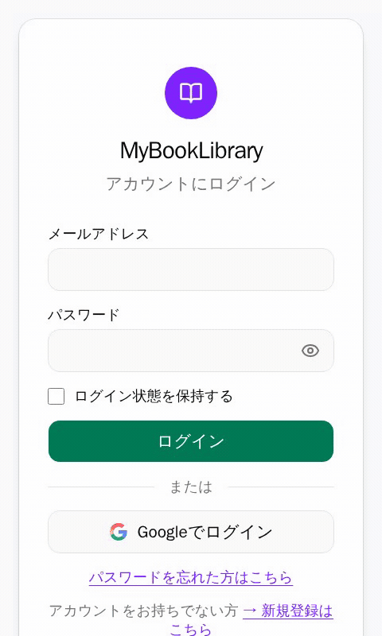
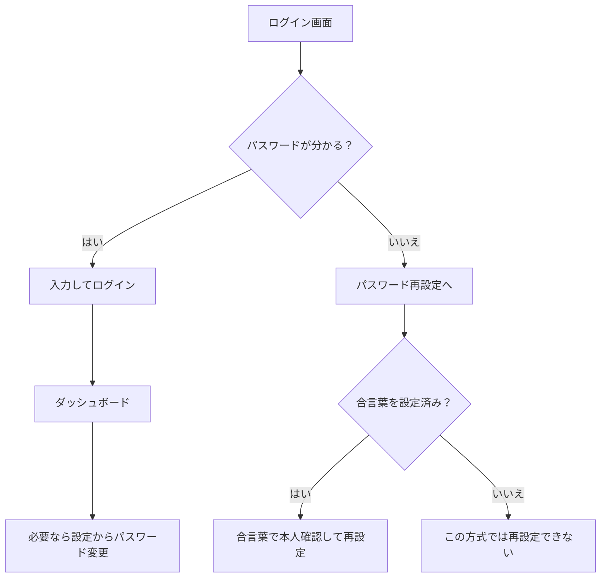

# 認証・アカウント管理 機能定義書

← [要件定義書に戻る](../requirements.md)

## 使い方

1. 初めて使う場合は、ログイン画面の「新規登録」からアカウントを作成します。メールアドレスとパスワードで登録する場合、合言葉は任意で設定できます。Google での登録も、有効な環境で利用できます（デモ環境を除く）。
2. ログイン画面でメールアドレスとパスワードを入力し、「ログイン」を押します。Google ログインも、有効な環境で利用できます（デモ環境を除く）。
3. ログイン中にパスワードを変更する場合は、設定画面の「パスワード」から進み、現在のパスワードで本人確認します。
4. パスワードを忘れた場合は、ログイン画面の「パスワードを忘れた方はこちら」へ進みます。合言葉を設定済みのアカウントでは、本人確認後に再設定できます。

## 実画面

メールアドレスとパスワードでログインする例。Google認証・新規登録・変更・再設定はこの映像には含みません。 外部通信を遮断したローカル環境の架空データによる画面です。

## 操作フローチャート

メールアドレスとパスワードによる通常のログイン時の、変更・再設定までの流れです。管理者による強制リセット後は、通常操作の前にパスワード変更が必要です。新規登録や Google ログインの手順は含みません。

## 注意点

- 設定からの変更には現在のパスワードが必要です。忘れた場合の再設定には、事前に設定した合言葉が必要です。
- Googleログインのみのアカウントとデモでは、パスワード・合言葉の操作に制限があります。

## 機能仕様

### 一般ユーザー

#### できること

- メールアドレスとパスワード、または Google で新規登録し、登録した方式でログインする。パスワードで登録済みのメールアドレスを Google ログインへ切り替えることはできない。
- パスワードでログインするアカウントは、設定から合言葉やパスワードを変更する。合言葉を設定済みなら、ログインできないときにもパスワードを再設定する。
- 設定で自分の情報を確認する。退会する場合は、自分のアカウントと読書記録などを削除する。

#### できないこと・条件

- 合言葉が未設定、または Google ログインのみの場合、合言葉方式でパスワードを再設定できない。
- Google ログインのみのアカウントでは、設定画面でパスワードや合言葉を設定・変更できない。

### 管理者

#### できること

- 管理画面の「設定」タブで、自分のアカウント情報（名前・メールアドレス・ロール）を確認する。パスワードでログインするアカウントでは、合言葉を設定・変更できる。
- 自分のパスワード変更は `/settings` から行う。一般ユーザーと同じ条件で、合言葉によるパスワード再設定も利用できる。
- 管理画面の「管理」タブにある「ユーザーロールの設定」で、パスワードを持つ対象ユーザーのパスワードを一時パスワードにリセットする。画面に表示された一時パスワードは、管理者が本人へ伝える。

#### できないこと・条件

- 管理者アカウントは自分で退会できない。Google ログインのみのアカウントは、管理者によるパスワードリセットの対象外。
- リセットされた本人は、パスワードを変更するまで通常の操作ができない。

### デモを試す人

#### できること

- 一般ユーザー用のデモアカウントでログインし、使い方や設定画面のアカウント情報（名前・メールアドレス・ロール）を確認する。

#### できないこと・条件

- 新規登録、Google ログイン、合言葉の設定・変更、パスワードの変更・再設定、退会はできない。

## 設計判断・理由

パスワードと合言葉の失敗回数・ロックを別々に管理します。合言葉による再設定では、更新時にも本人確認を行います。

技術詳細（保存・処理条件・関連画面／API）

### 動作条件と処理の仕組み

- 新規登録画面で合言葉（秘密の言葉）を任意で設定できる（2〜50文字）。未設定のまま登録した場合は、設定画面から後で設定できる
- 設定から開くパスワード変更画面で変更を確定するときに、現在のパスワードによる本人確認を行う。現在のパスワードと同じ値には変更できない（一時パスワードからの変更時も同じ）。
- 管理者がパスワードをリセットすると、リセットを知らせる案内を本人へ通知し、`mustChangePassword` を設定する。一時パスワード自体は通知に含めず、管理者の画面に表示して本人へ伝える。
- 設定画面で合言葉を設定・変更するときは、現在のパスワードで本人確認する。
- 合言葉の照合を 10 回失敗するとロック（15 分間）される。ロックはパスワード側の `loginFailCount`／`lockedUntil` とは別に、合言葉専用の `secretWordFailCount`／`secretWordLockedUntil` で管理する
- 誤入力後、残り試行回数がある場合はその回数を表示し、ロックされた場合はロックの案内を表示する（`/api/auth/remaining-attempts`）
- 削除時は、アカウントと読書記録などユーザーに紐づくデータを原子的にまとめて削除する。監査ログなどは保持する
- 設定画面のアカウント情報は、スマホでは折りたたみを開くと表示し、PCでは常に表示する。管理者のナビゲーションには設定へのリンクを表示しない。
- 管理者操作・合言葉更新などの重要イベントは監査ログ（`AuditLog`）に記録される。詳細は [管理者機能 機能定義書](./admin.md) を参照

#### 認証フロー

**Credentials 認証**

1.  メールアドレス＋パスワードで認証
2.  ログイン失敗時：`loginFailCount` をインクリメント
3.  10 回失敗で `lockedUntil` を現在時刻 + 15 分に設定
4.  ロック中はログイン不可（残り試行回数を `/api/auth/remaining-attempts` で取得可能）
5.  パスワードリセット成功時に `loginFailCount` と `lockedUntil` をリセット

**パスワードリセット（合言葉方式）**

1.  `step: "check"` — メールアドレスを確認。合言葉が未設定の場合は `SECRET_WORD_NOT_SET` エラーを返し、同種の通知がない場合に、本人へ設定を促すアプリ内通知を作成する
2.  `step: "verifySecretWord"` — 合言葉を照合する。10 回失敗で 15 分ロック。ロック中の照合は `SECRET_WORD_LOCKED`（10 回目の誤入力自体は `SECRET_WORD_INVALID`）
3.  `step: "reset"` — 合言葉を再検証したうえでパスワードを更新する（更新時にも合言葉を照合する）

**Google OAuth**

1.  Google アカウントでログイン → `Account` テーブルに OAuth 情報を保存
2.  Google ログインのみのアカウント（パスワードなし）はパスワードリセット不可（`GOOGLE_ACCOUNT` エラーを返す）

**セッション**

- JWT ストラテジー（`strategy: "jwt"`）
- トークンにユーザー ID（String 型）とロールと、ログイン保持の有無（`rememberMe`）を含める
- `/admin` パスへのアクセスは `role === "admin"` チェック
- 有効期間は、**最後にセッションが更新されてから**の長さ（セッションの取得・更新のたび、つまりページの移動などで JWT が再発行されるたびに延びる。`src/lib/sessionPolicy.ts`、`src/lib/sessionJwt.ts`）

| ログインの種類                                      | 有効期間                                                                                                             |
|-----------------------------------------------------|----------------------------------------------------------------------------------------------------------------------|
| 「ログイン状態を保持する」を付けない                | 8 時間（#737。画面側でも、ブラウザを閉じて開き直すとログアウトする）                                                 |
| 「ログイン状態を保持する」を付けた／Google ログイン | 30 日                                                                                                                |
| デモ環境（`DEMO_MODE`）                             | 15 分（#736）。15 分更新がなければ、次のリクエストで再ログインが必要になる（放置中の画面は、自動では切り替わらない） |

- Auth.js の `encode` は、発行のたびに有効期限を `now + maxAge` で上書きする。そのため、期間はトークンの `exp` ではなく、`jwt.encode` に渡す `maxAge` で決める
- `rememberMe` の印がない古いトークン（#737 より前に発行）は、保持あり（30 日）として扱う
- Cookie 自体の期限は、通常の環境では 30 日のまま（保持なしの 8 時間は、サーバーがトークンの期限で拒否する）。デモ環境では、Cookie の期限も 15 分になる

#### デモ環境での制限

デモの利用制限は上の「デモを試す人」を参照。環境設定の詳細：[デモ環境の方針と構成](../demo-environment.md)。

#### セキュリティ仕様

- パスワードと合言葉のハッシュ化（bcryptjs、コスト12）

### 関連画面

| パス                        | 画面名                                           |
|-----------------------------|--------------------------------------------------|
| `/admin`                    | 管理画面（管理・設定タブ） |
| `/login`                    | ログイン画面                                     |
| `/register`                 | ユーザー登録画面                                 |
| `/forgot-password`          | パスワードリセット画面                           |
| `/settings`                 | 設定画面（アカウント情報確認・合言葉設定・削除） |
| `/settings/change-password` | パスワード変更画面                               |

### 関連 API エンドポイント

| メソッド | パス                                   | 説明                                                                                                |
|----------|----------------------------------------|-----------------------------------------------------------------------------------------------------|
| POST     | `/api/auth/register`                   | ユーザー登録（合言葉は任意）                                                                        |
| POST     | `/api/auth/reset-password`             | パスワードリセット（step: check/verifySecretWord/reset）                                            |
| GET      | `/api/auth/remaining-attempts`         | ログイン試行残回数確認                                                                              |
| GET      | `/api/user/secret-word`                | パスワードログインと合言葉の設定状況の確認（`hasPasswordLogin`・`hasSecretWord`。管理画面の表示用） |
| POST     | `/api/user/secret-word`                | 合言葉の設定・変更（現在のパスワードでの本人確認が必要）                                            |
| POST     | `/api/user/change-password`            | ログイン中のパスワード変更                                                                          |
| POST     | `/api/admin/users/[id]/reset-password` | 管理者によるパスワード強制リセット                                                                  |
| DELETE   | `/api/user/delete`                     | 自分のアカウント削除（管理者は不可）                                                                |

### 関連ドキュメント

- [API 仕様書](../api-spec.md) — バリデーションルール・エラーコード詳細
- [ER 図](../er-diagram.md) — User・Account・Session テーブル構成

