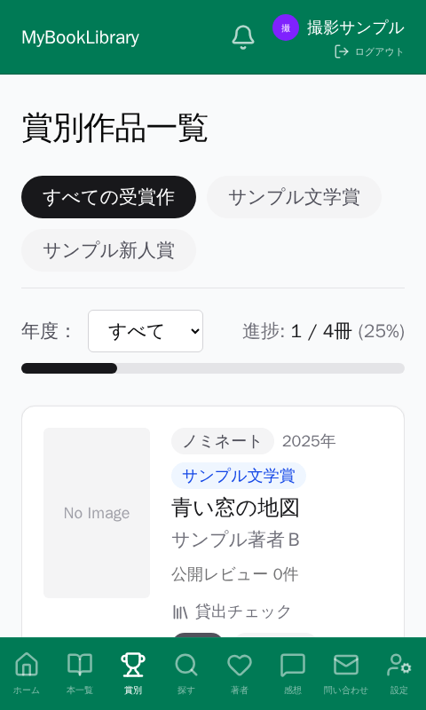
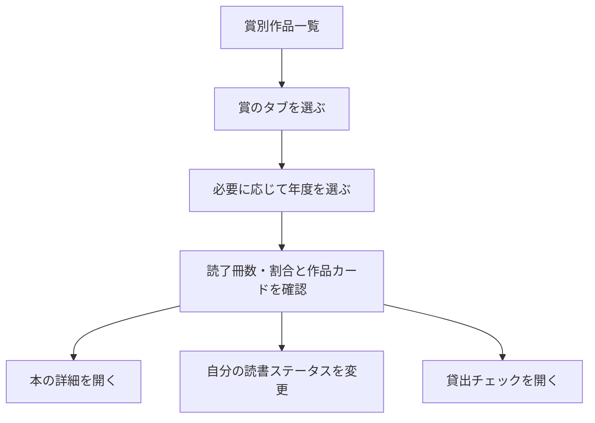

# 受賞・ノミネート作品一覧・読書進捗管理 機能定義書

← [要件定義書に戻る](../requirements.md)

## 使い方

「賞別作品一覧」で文学賞と年度を選びます。作品カードで「受賞」「ノミネート」を見分け、読んだ作品には「読了」を付けると、選んだ範囲の読了冊数と割合を確認できます。

## 実画面

ナビゲーションの「賞別」から「賞別作品一覧」を開きます。画面上部に賞のタブ、年度の選択欄、読了冊数と進捗バーが並びます。作品カードから本の詳細を開いたり、「貸出チェック」で版ごとの在庫を確認したりできます。

外部通信を遮断したローカル環境で、架空の文学賞と作品を使って撮影しました。

## 操作フローチャート

## 注意点

- 一覧にはアプリに登録済みの受賞作品・ノミネート作品が表示されます。
- 貸出状況を確認した後、予約する場合は図書館のサイトで手続きします。[図書館の在庫確認](./library.md)

## 機能仕様

### 一般ユーザー・管理者（共通）

#### できること

- 賞と年度で絞り込み、該当する作品と自分の読了率を確認する。
- 作品カードで自分の読書ステータスを記録し、公開レビュー件数や貸出状況を確認する。

#### できないこと・条件

- 作品一覧の操作は自分の読書記録に反映されます。賞名・年度・受賞区分などの受賞情報は管理者パネルで管理します。[管理者機能](./admin.md)

## 設計判断・理由

同じ本が複数の賞に入る場合も、進捗には同じ本を1冊として数えます。賞の登録情報と利用者ごとの読書記録を別々に扱うことで、作品一覧を使いながら自分の進捗を管理できます。

技術詳細（保存・処理条件・関連画面／API）

### 動作条件と処理の仕組み

- 選択中の賞・年度に該当する `Book` を重複なしで数え、利用者の `read` の件数から読了率を算出する。
- 各作品には受賞区分のバッジと「公開レビュー N件」（0件を含む）を表示する。同じ `Book` が複数の賞に出る場合も公開レビュー件数は共通。[公開レビュー件数の集計条件](./reviews.md#本の公開レビュー件数)
- 作品カードから、登録済みの版ごとの在庫確認ダイアログを開ける。[図書館連携](./library.md)

#### 対象文学賞

| 賞名 | 主催 | 頻度 |
| --- | --- | --- |
| 直木賞 | 日本文学振興会 | 年2回（上半期・下半期） |
| 芥川賞 | 日本文学振興会 | 年2回（上半期・下半期） |
| 本屋大賞 | 本屋大賞実行委員会 | 年1回 |
| このミステリーがすごい！ | 宝島社 | 年1回 |

### 関連画面

| パス | 画面名 |
| --- | --- |
| `/awards` | 受賞作品一覧（賞タブ・年度フィルター・読了率プログレスバー） |

### 関連 API エンドポイント

| メソッド | パス | 説明 |
| --- | --- | --- |
| GET | `/api/awards` | 文学賞一覧 |

### 関連ドキュメント

- [API 仕様書](../api-spec.md) — レスポンス形式
- [ER 図](../er-diagram.md) — Award・AwardEntry テーブル構成
- [管理者機能定義書](./admin.md) — 受賞データの登録・編集・CSV インポート
- [図書館連携 機能定義書](./library.md) — 在庫確認モーダルの詳細仕様

