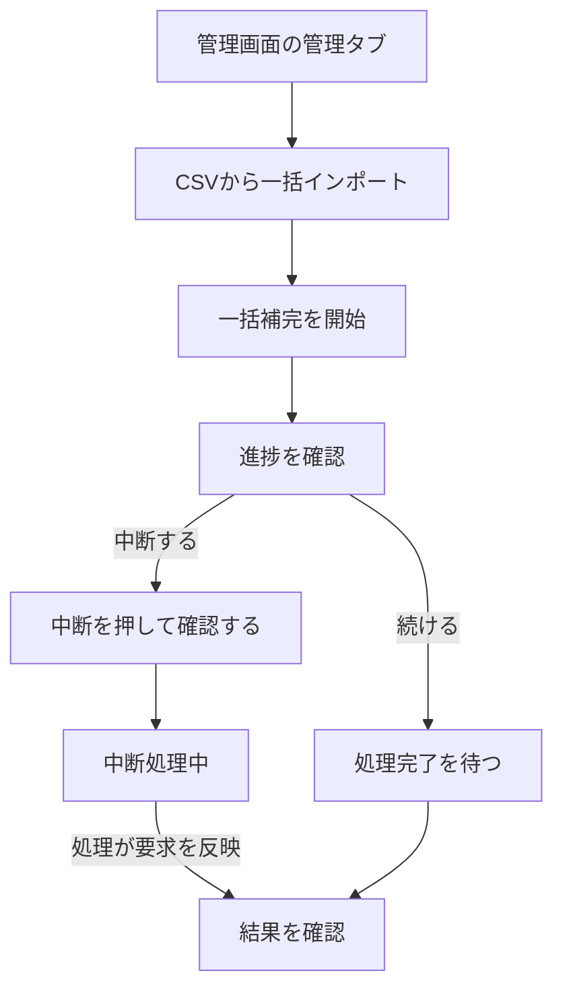

# 書籍情報補完処理 機能定義書

← [要件定義書に戻る](../requirements.md)

## 使い方

1. 管理画面の「管理」タブで「CSVから一括インポート」を開きます。
2. 「データ不足を補完」の「一括補完を開始」を押し、処理済み・成功・失敗の件数を確認します。
3. 処理を止める場合は「中断」を選びます。処理後は画面に表示された結果を確認します。「前回の結果を確認」から結果を開くこともできます。

## 実画面

隔離したローカル環境で、架空の本1件の補完を開始し、進捗が0件の状態で「中断処理中」と表示されるまでの例です。定期実行による補完結果や中断完了は収録範囲外です。

## 操作フローチャート

## 注意点

- 定期実行で処理する環境では、次の実行を待ちます。定期実行が無効の場合、開始したジョブは待機したままになります。
- 「中断処理中」は中断要求を受け付けた状態です。中断が完了するのは、実行中または次回の処理がその要求を反映したときです。
- 楽天ブックス・国立国会図書館で該当データを取得できない項目は、補完できない場合があります。

## 機能仕様

### 管理者

#### できること

- 登録済みの本で ISBN・表紙・出版日が不足しているものを補完する。管理者パネルで進捗と結果を確認する。

#### できないこと・条件

- すでに実行中のジョブがある場合や、補完対象の本がない場合は開始できない。

### 一般ユーザー・デモを試す人

#### できないこと・条件

- 管理用の補完処理を開始できない。

## 設計判断・理由

ジョブと本ごとの状態を保存して、定期実行のたびに続きから処理できるようにしています。新刊チェックとは実行時刻をずらし、同じ外部 API へのアクセスが集中しにくくしています。

技術詳細（保存・処理条件・関連画面／API）

### 動作条件と処理の仕組み

- 補完対象は `Book` テーブルのうち `isbn` が null、`coverImageUrl` が null、`publishedAtUnknown` が true のいずれかに該当する本
- 同時に実行できるジョブは1件のみ（既に `running` 状態のジョブがある場合は開始不可）
- 処理順は新しい本から（`bookId` 降順、同値ならアイテムの `id` 降順）。共通ワーカーの挙動変更のため、Cronモードに限らずAWS・ローカルの常駐ワーカーにも適用する。監査ログ用一覧の `id` 昇順は変更しない。
- ジョブの進捗は `BookEnrichmentJob`（合計件数・完了件数・成功件数・失敗件数・開始/終了/最終更新日時）で管理し、対象1件ごとの結果は `BookEnrichmentItem`（`pending`／`processing`／`done`／`error`／`cancelled` とエラーメッセージ）で管理する
- ワーカー（AWS 構成では EC2 の常駐プロセス）が再起動等で消失し、`running` のまま進捗が一定時間（3分）更新されないジョブは、`tick` エンドポイントの定期呼び出しにより再開される
- **Cloudflare Workers は Cron Trigger による分割実行**。`ENRICHMENT_MODE=cron` のときだけ有効で、開始APIはジョブ作成と監査ログ記録だけを行い、次の毎時Cronが処理する。AWS・ローカルは未設定のまま、従来の常駐ワーカーと3分停止時の再開を使う

#### 処理フロー

1. `POST /api/admin/book-enrichment/start` が対象を抽出し、`BookEnrichmentJob`（running）と項目（pending）を保存する。
2. Cronモードでは次のtick、従来モードではワーカーが処理を開始する。
3. 楽天・NDLの取得結果から本の欠損を補い、項目の結果とジョブの進捗を保存する。
4. 全件処理後に結果を確定する。中断要求は次の処理で検出し、未処理項目とジョブをcancelledにする。
5. 従来モードのtickは3分以上進捗が止まったrunningジョブを再開する。Cronモードのtickは全runningジョブを順に処理する。

#### セキュリティ

- `start`／`status`／`cancel` は管理者セッション必須
- `tick` は Bearer トークン認証必須（`ENRICHMENT_TICK_SECRET`、16文字以上）
- `/api/admin/book-enrichment/tick` は完全一致で proxy の公開パスとし、ルートが Bearer 認証を行う。Cloudflare の Cron / AWS の Lambda が Cookie なしで呼ぶため。`start` / `status` / `cancel` や `tick` の類似パスは公開しない。デモ環境は拒否し、secret 未設定・長さ不足は 500、Bearer なし・不一致は 401 を返す。

#### Workers の分割実行と制限

- 本番とステージングの vars に `ENRICHMENT_MODE="cron"` を設定する（ステージングは、確認のあと、Cronを無効にしたため、ジョブは進まない）。本番では、`30 * * * *` の Cron が `GET /api/admin/book-enrichment/tick` を専用secretで内部呼び出しする。デモには設定せず、デモの毎時tickイベントは何も呼ばず正常終了する。
- Cronモードのtickは、`lastTickAt` に関わらず全runningジョブを取得し、順にawaitする。応答は `{ processed: [jobId...] }`。従来モードの応答は `{ resumed: [jobId...] }` のまま。
- **1回のtick全体で20秒の経過時間予算**を共有する。各ジョブに残り予算を渡し、次のアイテム取得前に予算切れなら `lastTickAt` を更新してrunningのまま戻る。完了・cancelledにはしない。処理中の1件は打ち切らないので、実際の応答時間が20秒を超える場合がある。予算内で全件終了した場合の完了処理、中断要求による取消、期限切れアイテムの回収は従来どおり。
- 処理量は、**1時間あたり1回の呼び出しで20秒の予算内（数件〜十数件）**を想定する。外部APIの応答時間・フォールバック回数に依存するため、保証値ではなく未実測。
- 補完Cronは1時間に1回（毎時30分）。楽天APIは、利用者の検索・毎日の新刊チェックと、同じアプリIDで共有され、毎秒の上限があるため、補完は、短い実行（20秒）を、間隔を空けて行い、新刊チェック（UTC 00:00）とも、時刻を重ねない（実行が重なって、リクエスト速度が倍になることも避ける）。初回登録後の一括補完が主な用途で、その後の実行機会は少ないため、待機中の無駄な実行を減らす。1,000件に約4〜8日（1回あたり約5〜10件、1日24回として計算上の目安。実測ではない）かかることは許容する。
- 待機中も1日24回、実行中ジョブの確認（軽いクエリ）を行う。
- 毎時のCronでの時間・CPUの上限は、[Cloudflare公式の制限](https://developers.cloudflare.com/workers/platform/limits/)・[Cron Trigger資料](https://developers.cloudflare.com/workers/configuration/cron-triggers/)と、利用プラン・ステージングでの実測を合わせた確認が必要で、適合性は未確認。20秒はアプリの経過時間予算であり、CPU上限を示す値ではない。
- **ステージングでの確認（2026-10-29、旧設定）**: 変更前のCronが、`tick` を `status: 200` で呼べることを、`wrangler tail` で確認した（プロキシが `307` を返す問題の修正後）。ジョブの確認は、ユーザーがステージングで行い、確認できたと報告を受けた（詳細な結果の記録は、残していない）。毎時設定での確認ではなく、ステージングのCronは無効のまま。
- **未確認**: 進捗の継続、中断、実行時間・CPU、アイテム処理中の超過や中断後の再開の、詳細な実測。2026-10-29 時点の記録では、本番の `ENRICHMENT_TICK_SECRET` は未登録・未反映。現在の登録・反映状況は未確認です。

### 関連画面

| パス | 画面名 |
| --- | --- |
| `/admin` | 管理画面の「管理」タブ →「CSVから一括インポート」の「データ不足を補完」 |

### 関連 API エンドポイント

| メソッド | パス                                | 説明                                    |
|----------|-------------------------------------|-----------------------------------------|
| POST     | `/api/admin/book-enrichment/start`  | 補完ジョブを開始                        |
| GET      | `/api/admin/book-enrichment/status` | ジョブの進捗・失敗項目を取得            |
| POST | `/api/admin/book-enrichment/cancel` | 中断を要求 |
| GET      | `/api/admin/book-enrichment/tick`   | 停止中のジョブを再開（Bearer 認証必須） |

### 関連ドキュメント

- [ER 図](../er-diagram.md) — BookEnrichmentJob・BookEnrichmentItem テーブル構成
- [管理者機能 機能定義書](./admin.md) — 管理者パネルからの操作
- [本の一覧・検索 機能定義書](./book-search.md) — 補完対象となる Book のデータ取得元

