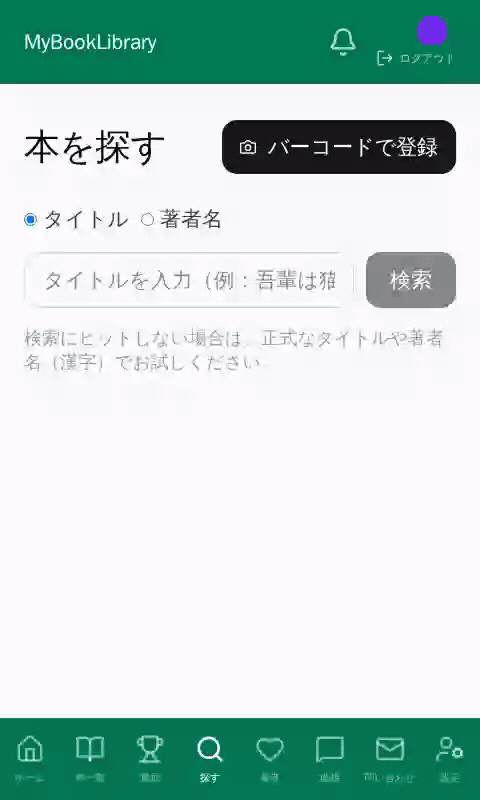
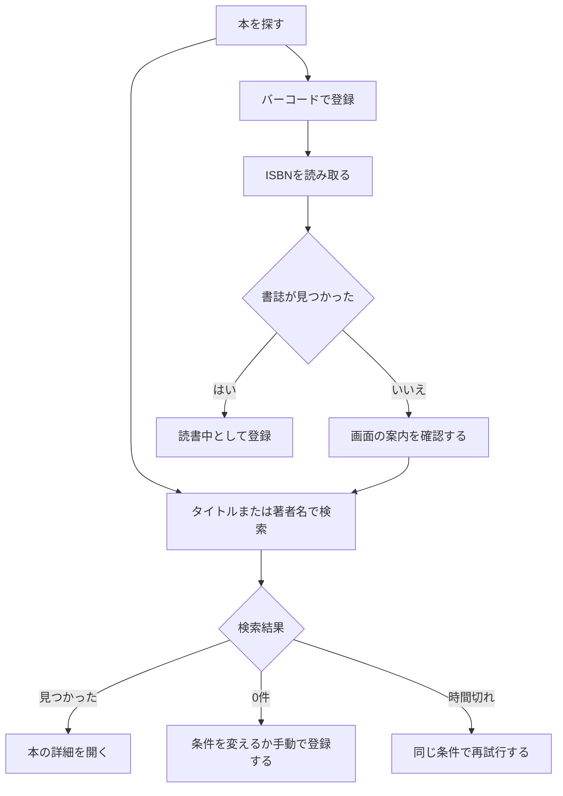

# 本の一覧・検索 機能定義書

← [要件定義書に戻る](../requirements.md)

## 使い方

「本を探す」で「タイトル」または「著者名」を選び、検索します。見つかった本のタイトルを選ぶと詳細が開きます。手元に本がある場合は「バーコードで登録」から、見つからない場合は「手動で登録する」から読書記録に追加できます。

## 実画面

外部通信を遮断したローカル環境で、外部APIの応答を架空の書誌データに置き換えて撮影した画面です。

## 操作フローチャート

## 注意点

- 検索が時間切れになったときは再試行できます。追加の結果を読み込む途中で時間切れになっても、すでに表示されている結果は残ります。
- バーコードを読むにはカメラの使用許可が必要です。読み取った本が見つかると「読書中」として登録されます。すでに読書中の場合は案内が表示されます。
- 取得元によっては書影が表示されない本もあります。

## 機能仕様

### 一般ユーザー・管理者（共通）

#### できること

- タイトル・著者名で検索するか、ISBNのバーコードを読み取って本を探す。
- 手動登録したい場合は、タイトル・著者名と記録する読書ステータスを入力する。ISBN・出版日・表紙画像URLは任意。
- 「私の本一覧」を読書ステータスや著者で絞り込む。

#### できないこと・条件

- 一般の詳細画面で書誌を編集・削除できるのは、自分が手動登録した本です。管理者向けの手動登録書籍の管理・マージは管理者パネルで行います。[管理者機能](./admin.md)

## 設計判断・理由

一覧では版の違いによる重複を整理し、読書記録では既存の本にひも付けます。検索の時間切れと0件を区別し、追加の読み込みに失敗しても表示済みの結果から探し続けられるようにしています。

技術詳細（保存・処理条件・関連画面／API）

### 動作条件と処理の仕組み

- 本一覧・検索結果・本詳細ヘッダーに「公開レビュー N件」（0件を含む）を表示する。[公開レビュー件数の集計条件](./reviews.md#本の公開レビュー件数)
- ISBN から直接詳細画面へ進む導線には `/books/isbn/[isbn]` を使う。カメラで読み取った ISBN は `/api/books/isbn` で書誌を取得する。
- 読書ステータス追加時に同タイトル・同著者の本が登録済みの場合は、版違いでも既存の本にひも付ける。
- 手動登録は `POST /api/reading-status` を使用し、書籍を新規作成する場合は `source: "manual"` とする。[管理者の手動登録書籍の管理・マージ](./admin.md)

#### 書籍データ取得優先順位

| データ | 取得方法 |
| --- | --- |
| 書影・タイトル・著者名・出版年 | 楽天ブックス API（主） |
| ISBN 検索フォールバック | 国立国会図書館 SRU API |
| タイトル・著者検索のフォールバックや補完 | 国立国会図書館 SRU API |

国立国会図書館（NDL）由来の検索結果には書影がありません。

#### 重複排除ロジック

1.  タイトルを NFKC 正規化・スペース除去して比較
2. 楽天ブックス API の同タイトルの結果では、単行本、新書、文庫、その他の順に優先し、同じ優先度なら出版年の古い版を採用する。

### 検索の時間制限

- 楽天は1回3秒、再試行を含む1呼び出し全体5秒。NDLは本文の読み取りも含め4秒。検索APIの外部呼び出しは共通の8秒予算を共有する（NDLによる補完も対象）。
- 時間切れは部分結果を返さず、HTTP 504 と `code: "SEARCH_TIMEOUT"`、`error: "外部の検索が時間内に終わりませんでした。しばらくしてから、もう一度お試しください。"` を返す。正常な0件は200・空の結果で区別する。時間切れ以外の外部API失敗とレート制限429は従来どおり。
- ブラウザは検索リクエストと本文の読み取りを15秒で中断する。504とブラウザの時間切れは「検索に時間がかかっています。もう一度お試しください。」を表示し、読み込み表示を解除する。
- 初回検索の再試行は同じ検索条件で1ページ目から実行する。追加読み込みの時間切れでは表示済みの結果を保持し、再試行で同じ追加ページを取得する。時間切れ後の古い応答は採用しない。
- 既定では外部APIヘルパーの失敗時の空結果を維持し、検索だけが `throwOnTimeout: true` を指定する。書誌補完・版の解決・カーリルの設定は変更しない。

### 関連画面

| パス | 画面名 |
| --- | --- |
| `/books` | マイ本一覧 |
| `/books/search` | 本の検索（バーコードスキャン対応） |
| `/books/[id]` | 本の詳細 |
| `/books/isbn/[isbn]` | ISBN 書籍詳細 |

### 関連 API エンドポイント

| メソッド | パス | 説明 |
| --- | --- | --- |
| GET | `/api/books/search` | 楽天 API で書籍検索 |
| GET | `/api/books/isbn` | ISBN で書籍情報を取得 |
| GET | `/api/books/reading` | 読書中・読了の本一覧 |
| PATCH | `/api/books/[id]` | 本の編集（手動登録者本人のみ） |
| DELETE | `/api/books/[id]` | 本の削除（手動登録者本人のみ） |

本の詳細（`/books/[id]`）は、ページ側（サーバー）で取得する。取得用の API（`GET /api/books/[id]`）は、ない。

#### 書影の表示

書影は任意hostのHTTP(S) URLを表示し、欠落・非対応URL・取得失敗は共通のNo Imageへ切り替える。URLが変更された場合は新しい書影を試す。手動入力の条件とCSPの制限は[ブラウザーの保護と外部コンテンツ](../browser-protection.md)を参照。

### 関連ドキュメント

- [API 仕様書](../api-spec.md) — 検索クエリパラメータ・レスポンス形式
- [ER 図](../er-diagram.md) — Book テーブル構成

