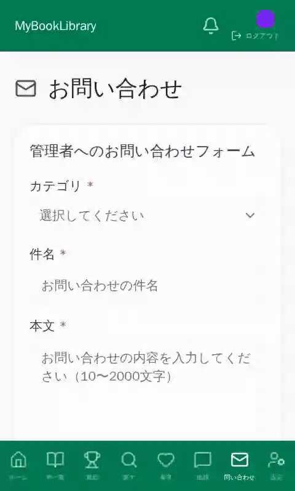
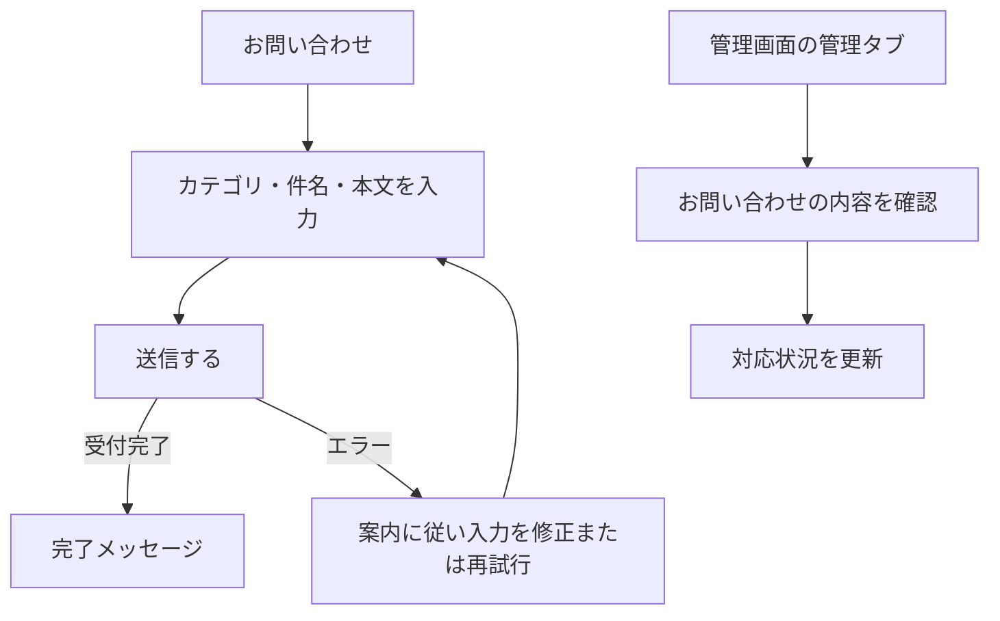

# お問い合わせ 機能定義書

← [要件定義書に戻る](../requirements.md)

## 使い方

1. ログインし、「お問い合わせ」を開きます。
2. カテゴリを選び、件名と本文を入力して「送信する」を押します。画面に表示された自分の名前・メールアドレスで送信されます。
3. 「お問い合わせを受け付けました」と表示されたら受付完了です。

## 実画面

隔離したローカル環境で、架空のお問い合わせを送信して受付完了を確認する例です。管理者側の対応は収録範囲外です。

## 操作フローチャート

利用者の送信が完了すると、管理者は管理画面で内容を確認できます。

## 注意点

- 受付完了の表示は、問い合わせが保存されたことを示します。対応状況は管理者が管理画面で更新します。

## 機能仕様

### 一般ユーザー

#### できること

- カテゴリ・件名・本文を入力して問い合わせを送る。

#### できないこと・条件

- ログインが必要。件名は1〜100文字、本文は10〜2000文字。

### 管理者

#### できること

- 管理画面の「管理」タブで問い合わせ内容を確認し、未対応・対応済みを切り替える。不要な問い合わせは削除できる。

### デモを試す人

#### できないこと・条件

- デモでは問い合わせを送信できない。

## 設計判断・理由

受付時の名前・メールアドレスと対応状況を問い合わせに紐づけます。管理者が内容を確認しながら対応状況を管理できます。

技術詳細（保存・処理条件・関連画面／API）

### 動作条件と処理の仕組み

- カテゴリは以下の5種類

| カテゴリ   | 説明                         |
|------------|------------------------------|
| 一般的なお問い合わせ | 一般的な問い合わせ           |
| 不具合の報告 | 不具合・バグの報告           |
| 機能追加の要望 | 新機能・改善の提案           |
| アカウントについて | アカウントに関する問い合わせ |
| その他     | 上記に当てはまらない内容     |

- 送信済みのお問い合わせは `ContactInquiry` として保存される
- 送信者の名前・メールアドレスはセッションから取得する。フォームでは現在の名前とメールアドレスを表示する。

#### 管理者側の対応

- 対応状況の保存値は open（未対応）と closed（対応済み）。
- 管理画面では送信者のメールアドレスをマスクする。全体の表示と監査記録は [管理者機能](./admin.md#メールアドレスのマスク表示) を参照。

### 関連画面

| パス       | 画面名                                           |
|------------|--------------------------------------------------|
| `/contact` | お問い合わせフォーム                             |
| `/admin`   | 管理者パネル（お問い合わせ一覧・ステータス管理） |

### 関連 API エンドポイント

| メソッド | パス                        | 説明                       |
|----------|-----------------------------|----------------------------|
| POST     | `/api/contact`              | お問い合わせ送信           |
| GET      | `/api/admin/inquiries`      | お問い合わせ一覧（管理者） |
| PATCH    | `/api/admin/inquiries/[id]` | ステータス更新（管理者）   |
| DELETE   | `/api/admin/inquiries/[id]` | お問い合わせ削除（管理者） |

### 関連ドキュメント

- [API 仕様書](../api-spec.md) — バリデーションルール
- [ER 図](../er-diagram.md) — ContactInquiry テーブル構成

