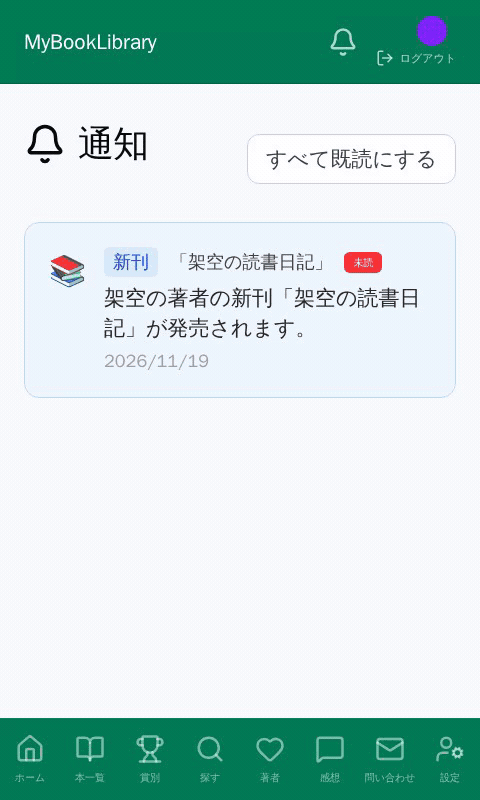
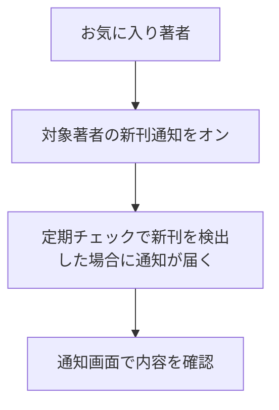
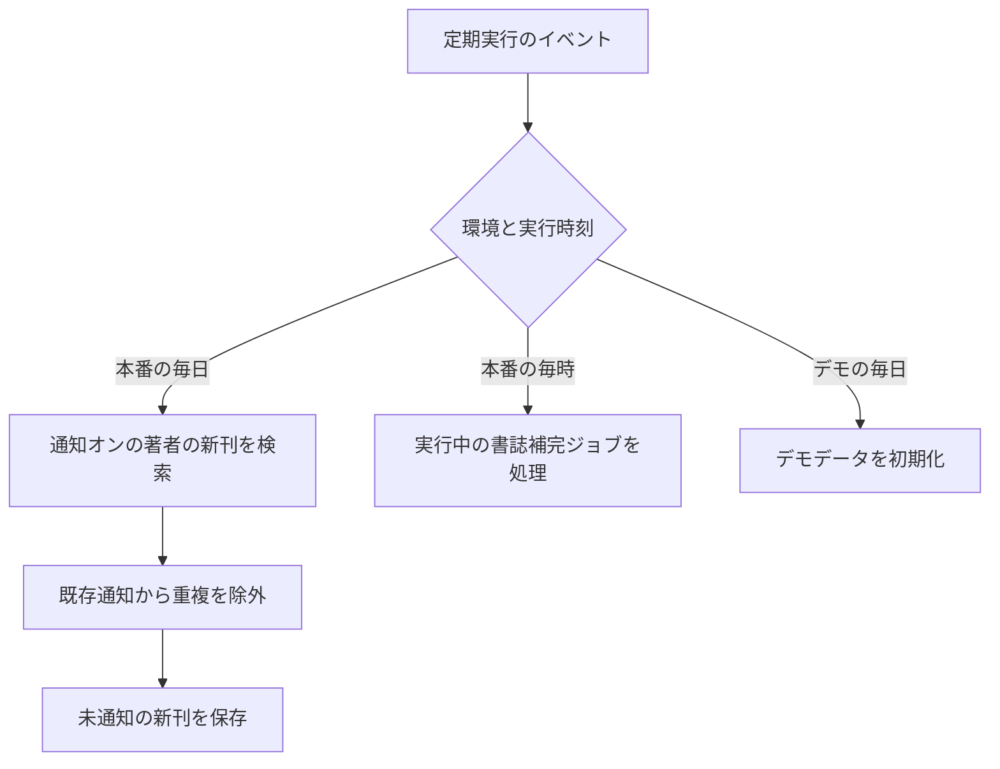

# 新刊チェック（Cron） 機能定義書

← [要件定義書に戻る](../requirements.md)

## 使い方

1. 「お気に入り著者」で、対象の著者の新刊通知をオンにします。
2. 定期チェックで新刊が検出されると、アプリの「通知」で確認できます。

## 実画面

隔離したローカル環境で、事前に用意した架空の新刊通知を確認する例です。定期チェックには専用の画面がなく、実行や新刊検出は収録範囲外です。

## 操作フローチャート

### 定期処理の流れ

## 注意点

- 新刊チェックは設定された時刻に自動実行されます。利用者が実行する操作はありません。
- デモの定期処理はデータ初期化用です。デモでは新刊チェックを定期実行しません。

## 機能仕様

### 一般ユーザー

#### できること

- お気に入り著者の通知をオンにし、新刊が検出されたときはアプリ内の通知で確認する。

#### できないこと・条件

- 利用者が定期処理を手動で実行する機能ではない。

### 運用担当者

#### できること

- 環境ごとの実行設定・時刻・失敗記録を確認する。

#### できないこと・条件

- 現在の稼働状態を確認するには、対象環境の実行記録が必要。

### デモを試す人

#### できないこと・条件

- デモの定期処理はデータ初期化用で、定期の新刊チェックは行わない。

## 設計判断・理由

通知の重複を防ぐ制約を設け、次の実行でも同じ新刊を繰り返し通知しないようにします。新刊チェックと書誌補完の実行時刻も分けます。

技術詳細（保存・処理条件・関連画面／API）

### 動作条件と処理の仕組み

- 通知をオンにしたお気に入り著者について楽天ブックス API で検索し、ISBN があり、発売日を解釈できる本を対象とする。判定の下限は実行時点の1週間前で、発売予定の本も対象となる。
- 同じ新刊で重複通知は作成しない（`Notification` テーブルに `@@unique([userId, type, bookIsbn])` 制約）

#### 実行フロー

    Cloudflare Cron Trigger（毎日 UTC 00:00 = JST 09:00。本番のみ）
      ↓
    Worker の scheduled ハンドラ（src/lib/cronScheduler.ts）が、Worker 内の fetch を直接呼ぶ
      ↓
    GET /api/cron/check-new-books（Bearer = Worker の secret CRON_SECRET）
      ↓
    お気に入り著者一覧を取得
      ↓
    各著者の楽天ブックス API の検索結果から、発売日が1週間前以降の本を抽出
      ↓
    新刊が見つかった場合 → 通知 ON のユーザーごとに既存通知を取得
      ↓
    重複チェック（同 userId・bookIsbn の通知が既存なら、種類に関わらず除外）
      ↓
    未通知の新刊を一括登録（MySQL は `createMany`、D1 はバインド変数の上限に合わせて分割）

発売日の確定度と日本時間の日付に応じて、通知文を「発売予定です」「発売されました」に分ける。

#### 環境ごとの Cron

| 環境         | Cron                                  | 実行内容                                                                                                                                                                        |
|--------------|---------------------------------------|---------------------------------------------------------------------------------------------------------------------------------------------------------------------------------|
| 本番         | `0 0 * * *`（UTC 00:00 = JST 09:00）  | 新刊チェック                                                                                                                                                                    |
| 本番         | `30 * * * *`（毎時30分）              | 書誌補完tick（`ENRICHMENT_TICK_SECRET`）。新刊チェック（毎日 UTC 00:00）と、楽天APIを使う時刻が重ならないよう、30分にずらしている                                               |
| ステージング | なし（無効）                          | 書誌補完の旧Cronは、2026-10-29 の確認のあと、無効にした。新刊チェックも無効（本番との二重通知を防ぐ）。補完を開始してもジョブは進まない。「中断」で要求は保存できるが、中断完了にも次の処理実行が必要 |
| デモ         | `0 18 * * *`（UTC 18:00 = JST 03:00） | 新刊チェックの代わりに、デモのデータの初期化（`GET /api/cron/reset-demo`。[デモ環境の方針](../demo-environment.md)）                                                            |

`scheduled` ハンドラ（エントリは `app/worker/index.mjs`）は、secret `CRON_SECRET` が未設定のとき、または API が 2xx 以外を返したときは、失敗として記録する。Cloudflare の Cron は自動で再試行しないが、API は重複通知を作らない冪等な作りのため、次の定時実行で回復する。ローカルでの手動実行は `wrangler dev --test-scheduled`。詳細は [Cloudflare へのデプロイ](../cloudflare-deploy.md) と [移行計画](../archive/cloudflare-d1-migration-plan.md) §4-4 の実装メモを参照。

毎時の式は書誌補完専用で、`GET /api/admin/book-enrichment/tick` を `ENRICHMENT_TICK_SECRET` で呼ぶ。未設定なら失敗する。デモの毎時イベントはsecret確認前にスキップして正常終了する。他の式は従来の `CRON_SECRET` と新刊チェック／デモ初期化を使う。分割実行の予算・未確認事項は[書誌補完仕様](./book-enrichment.md#workers-の分割実行と制限)を参照。

本番の毎日の新刊チェック `0 0 * * *` と毎時の補完 `30 * * * *` は実行時刻を30分ずらしている。`controller.cron` の文字列で呼び先とBearerを区別する。補完は1回20秒の予算で数件〜十数件の見込み、1,000件に約4〜8日（計算上の目安で実測ではない）。待機中は1日24回の軽い確認クエリを行う。処理順は新しい本（`bookId` 降順）からで、AWSの常駐ワーカーも共通。毎時実行の時間・CPU上限への適合性は未確認で、20秒の予算は変更しない。

#### AWS 構成（停止中）

EventBridge ルール（毎日 UTC 00:00）が Lambda を起動し、Lambda が同じ `GET /api/cron/check-new-books` を Bearer 認証で呼ぶ。設定は [AWS デプロイガイド](../aws/aws-app-deploy-guide.md) を参照。

#### セキュリティ

- `/api/cron/check-new-books` は Bearer トークン認証必須
- `/api/cron/` 配下はプロキシのセッション認証を通さず、対象ルートの Bearer 認証で保護する。

### 関連画面

| パス | 画面名 |
| --- | --- |
| `/favorite-authors` | 新刊通知のオン・オフを設定する画面 |
| `/notifications` | 通知を確認する画面 |

### 関連 API エンドポイント

| メソッド | パス                        | 説明                                                                    |
|----------|-----------------------------|-------------------------------------------------------------------------|
| GET      | `/api/cron/check-new-books` | 新刊チェック（Bearer 認証必須）                                         |
| GET      | `/api/cron/reset-demo`      | デモ環境のデータの初期化（Bearer 認証必須。`DEMO_MODE` のときだけ動く） |
| GET | `/api/admin/book-enrichment/tick` | 書誌補完ジョブの処理・再開（専用 Bearer 認証） |

### 関連ドキュメント

- [ER 図](../er-diagram.md) — Notification テーブル構成
- [通知機能定義書](./notifications.md) — 生成された通知の表示
- [お気に入り著者管理定義書](./favorite-authors.md) — 通知 ON/OFF 設定
- [Cloudflare へのデプロイ](../cloudflare-deploy.md) — Cron Trigger の設定
- [AWS デプロイガイド](../aws/aws-app-deploy-guide.md) — Lambda・EventBridge の設定（停止中）

