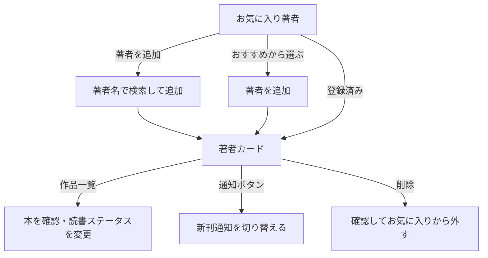

# お気に入り著者管理 機能定義書

← [要件定義書に戻る](../requirements.md)

## 使い方

1. 「お気に入り著者」の「著者を追加」で、著者名を検索して追加します。表示されている「おすすめ」から選ぶこともできます。
2. 追加した著者の通知ボタンで新刊通知をオン・オフにします。
3. 著者名や「作品一覧」から本を探し、各作品の読書ステータスを変更できます。お気に入りを外す場合は、著者カードで削除を選びます。

## 実画面

隔離したローカル環境で、架空の検索結果から著者を追加して新刊通知をオフにする例です。作品一覧の表示やお気に入りからの削除は収録範囲外です。

## 操作フローチャート

## 注意点

- 新刊通知をオンにした著者について、定期チェックで新刊が見つかると、アプリ内に通知されます。

## 機能仕様

### 一般ユーザー

#### できること

- お気に入り著者の一覧を確認し、著者の追加・削除と新刊通知の切り替えを行う。
- 著者ごとの作品一覧をタイトルで絞り込み、作品ごとの読書ステータスを更新する。

#### できないこと・条件

- 著者の追加や通知の設定にはログインが必要。通知の対象は [新刊チェック](./cron.md) の検索結果に含まれる本。

## 設計判断・理由

著者名の表記を正規化して同一著者を扱い、通知の希望は利用者ごとに保存します。

技術詳細（保存・処理条件・関連画面／API）

### 動作条件と処理の仕組み

- 著者名検索は楽天ブックス API を使い、著者が見つからない場合は国立国会図書館 API を使う。おすすめから追加する場合は、既存の著者 ID で登録する。
- 新刊通知の設定はユーザーと著者の組み合わせで保持する。お気に入りに追加した直後はオン。

#### 書籍一覧の表示仕様

- 各本に「公開レビュー N件」（0件を含む）を表示する。代表外ISBNも同じBookの公開件数を参照する。[集計条件](./reviews.md#本の公開レビュー件数)

- タイトルの重複を NFKC 正規化で排除（全角・半角・スペース差異を吸収）

- 同タイトルが複数版ある場合は最古出版年（初版）を表示

- 単行本優先で版種を選択

### 関連画面

| パス                           | 画面名             |
|--------------------------------|--------------------|
| `/favorite-authors`            | お気に入り著者一覧 |
| `/favorite-authors/[authorId]` | 著者別書籍一覧     |

### 関連 API エンドポイント

| メソッド | パス                               | 説明                     |
|----------|------------------------------------|--------------------------|
| GET      | `/api/authors`                     | 著者一覧                 |
| GET      | `/api/authors/search`              | 著者検索                 |
| GET      | `/api/favorite-authors`            | お気に入り著者一覧       |
| POST     | `/api/favorite-authors`            | 著者をお気に入り登録     |
| PATCH    | `/api/favorite-authors/[authorId]` | 新刊通知 ON/OFF 切り替え |
| DELETE   | `/api/favorite-authors/[authorId]` | お気に入りから削除       |

### 関連ドキュメント

- [API 仕様書](../api-spec.md) — 書籍一覧レスポンス形式
- [ER 図](../er-diagram.md) — FavoriteAuthor テーブル構成
- [新刊チェック（Cron）定義書](./cron.md) — 新刊通知の自動生成
- [通知機能定義書](./notifications.md) — 新刊通知の表示

