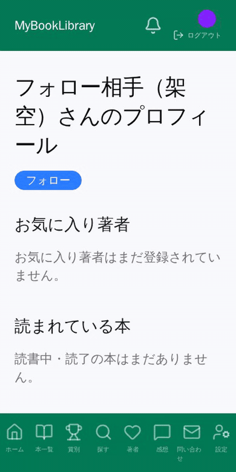
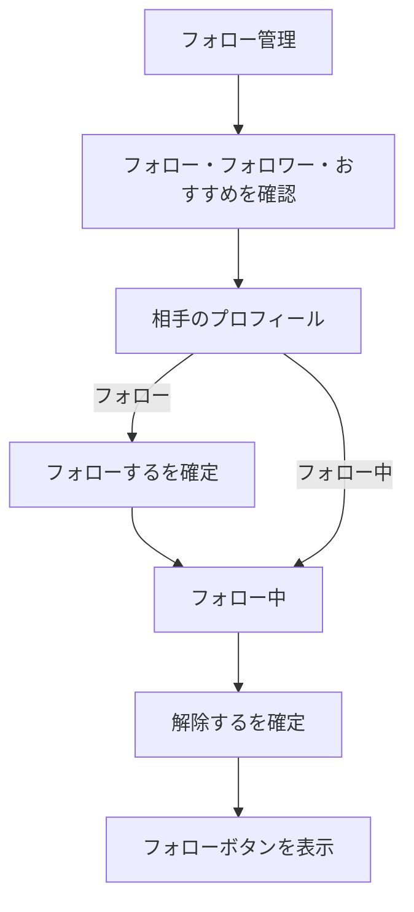

# フォロー機能 機能定義書

← [要件定義書に戻る](../requirements.md)

## 使い方

1. 「フォロー管理」では「フォロー」「フォロワー」「おすすめ」を確認できます。
2. 相手のプロフィールで「フォロー」を選び、確認画面で「フォローする」を押します。
3. 解除する場合は、相手のプロフィールで「フォロー中」を選び、確認画面で「解除する」を押します。

## 実画面

隔離したローカル環境で、架空のユーザーをフォローしてから解除する例です。相互フォローの成立や活動通知は収録範囲外です。

## 操作フローチャート

## 注意点

- ログインすると、フォロー関係にかかわらず、相手のお気に入り著者や読書状況を確認できます。
- 相互フォローが解消されると、相互フォロー限定の活動通知が削除されます。

## 機能仕様

### 一般ユーザー・管理者（共通）

#### できること

- 相手をフォロー・解除し、フォロー中とフォロワーの一覧を確認する。フォローされた側にはフォローバックを案内する通知が届く。
- 相互フォロー中の相手がお気に入り著者や読みたい本を追加すると、活動通知が届く。

#### できないこと・条件

- 自分自身はフォローできない。すでにフォロー中の利用者は「おすすめ」に表示されない。

## 設計判断・理由

共通のお気に入り著者が多い相手を、おすすめフォロー候補として表示します。

技術詳細（保存・処理条件・関連画面／API）

### 動作条件と処理の仕組み

- フォローの関係を `Follow` に保存する。フォローした相手と自分の両方向に関係があれば相互フォローになる。
- おすすめフォロー候補は、フォロー一覧画面（`/settings/follows`）がサーバー側で直接取得して表示する。共通してお気に入り登録している著者の数が多い順に提示する（既にフォロー中のユーザーと自分自身は除外）
- ユーザー詳細で表示する読書状況は「読みたい」「読書中」「読了」の本。
- フォロー解除・アカウント削除時は、この相互フォローに紐づく活動通知を削除する。[通知の種類と条件](./notifications.md#通知の種類)

### 関連画面

| パス                | 画面名       | 説明                                                     |
|---------------------|--------------|----------------------------------------------------------|
| `/settings/follows` | フォロー一覧 | フォロー中・フォロワーの一覧、おすすめフォロー候補の表示 |
| `/users/[id]`       | ユーザー詳細 | 他ユーザーのプロフィール確認・フォロー／フォロー解除     |

### 関連 API エンドポイント

| メソッド | パス                               | 説明                                                                                         |
|----------|------------------------------------|----------------------------------------------------------------------------------------------|
| POST     | `/api/follows`                     | ユーザーをフォロー                                                                           |
| DELETE   | `/api/follows`                     | フォロー解除                                                                                 |
| GET      | `/api/users/[id]/favorite-authors` | 他のユーザーの、お気に入り著者と、読んでいる本（読みたい・読書中・読了）の取得（認証が必要） |

### 関連ドキュメント

- [ER 図](../er-diagram.md) — Follow テーブル構成
- [お気に入り著者管理 機能定義書](./favorite-authors.md) — おすすめ候補の算出に利用するデータ

