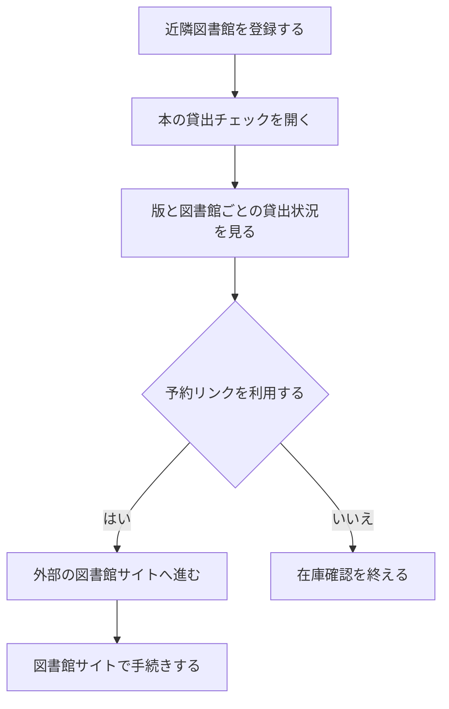

# 近隣図書館の在庫確認 機能定義書

← [要件定義書に戻る](../requirements.md)

## 使い方

設定の「近隣図書館の設定」で、よく利用する図書館を最大5館登録します。本の一覧や詳細で「貸出チェック」を選ぶと、登録した図書館の貸出状況を確認できます。

## 実画面

「私の本一覧」「本を探す」、著者別書籍一覧、賞別作品一覧、本の詳細から「貸出チェック」を開きます。「版ごとの在庫状況」にはISBNごとの貸出状況が並びます。「予約する」が表示されている場合は、そのリンクから図書館の予約ページを新しいタブで開けます。

## 操作フローチャート

## 注意点

- 貸出状況は問い合わせ時点の情報です。予約が必要な場合は図書館のサイトで手続きします。
- 登録図書館やISBNがない場合は、在庫確認の画面に案内が表示されます。

## 機能仕様

### 一般ユーザー・管理者（共通）

#### できること

- 登録した図書館で、同じ本の版ごとに貸出状況を確認する。
- 一般ユーザーは設定画面、管理者は管理者パネルまたは設定画面で、図書館を最大5館まで登録する。

#### できないこと・条件

- 予約リンクは、対象の貸出状態で有効なリンクがある場合に表示される。手続きは図書館のサイトで行う。
- 貸出確認の操作だけでは本や読書ステータスは登録されない。

## 設計判断・理由

複数のISBNを版ごとに確認することで、単行本と文庫などの貸出状況を見比べられます。貸出確認は閲覧として扱い、本棚への登録や図書館側の予約手続きと分けています。

技術詳細（保存・処理条件・関連画面／API）

### 動作条件と処理の仕組み

- 管理者のナビゲーションからは管理者パネルを開ける。設定画面は `/settings` からも利用できる。
- 登録した図書館の貸出状況はカーリル API に問い合わせる。図書館の登録が0館の場合は、ダイアログに案内を表示する。

| 状態 | 表示 |
| --- | --- |
| 貸出可 | 緑バッジ |
| 貸出中 | 赤バッジ |
| 蔵書なし | グレーバッジ |

- 対象の貸出状態で有効な HTTP(S) の URL がある場合は、貸出状況の横に「予約する」を表示する。別タブで開く外部リンクとして案内し、予約先URLが無効でも貸出状態は表示する。[外部リンクの保護方針](../browser-protection.md)
- 登録済みの本は登録された全ISBN（版）を確認する。代表ISBNがなくても版のISBNがあれば確認でき、ISBNが1件もない場合はその旨を表示する。変換可能なISBN-13とISBN-10は同じ版の結果にまとめる。
- 本IDのない検索・著者一覧の本はISBNから既存の本を検索し、存在する場合は全版、未登録の場合はそのISBNを確認する。確認操作では本や読書状態を登録しない
- カーリル API はポーリング方式のため、結果取得まで最大数秒かかる場合がある

### 関連画面

| パス | 画面名 |
| --- | --- |
| `/settings` | 設定画面（図書館の登録・削除） |
| `/admin` | 管理者パネル（管理者の近隣図書館設定） |
| `/books` | マイ本一覧（在庫確認ボタン） |
| `/books/[id]` | 本詳細（版ごとの在庫確認モーダル） |
| `/books/search` | 本の検索（在庫確認ボタン） |
| `/favorite-authors/[authorId]` | 著者別書籍一覧（在庫確認ボタン） |
| `/awards` | 受賞作品一覧（在庫確認ボタン） |

### 関連 API エンドポイント

| メソッド | パス | 説明 |
| --- | --- | --- |
| GET | `/api/user-libraries` | 登録図書館一覧取得 |
| POST | `/api/user-libraries` | 図書館を登録（最大 5 件） |
| DELETE | `/api/user-libraries` | 図書館の登録解除 |
| GET | `/api/calil/libraries` | カーリル API で図書館を検索（地域・座標から候補を取得） |
| GET | `/api/calil/check` | カーリル API で図書館在庫確認（`isbn` / `libraries` クエリ、単一ISBN向け） |
| GET | `/api/calil/check-book` | 共通の在庫確認モーダル用。`bookId` または `isbn` クエリで本を特定し、登録済み全ISBN（未登録の本は指定ISBN）の在庫状況を一括確認 |

### 関連ドキュメント

- [API 仕様書](../api-spec.md) — カーリル API パラメータ・レスポンス形式
- [ER 図](../er-diagram.md) — Library・BookIsbn テーブル構成
- [受賞・ノミネート作品一覧 機能定義書](./awards.md) — 賞別作品一覧からの在庫確認

