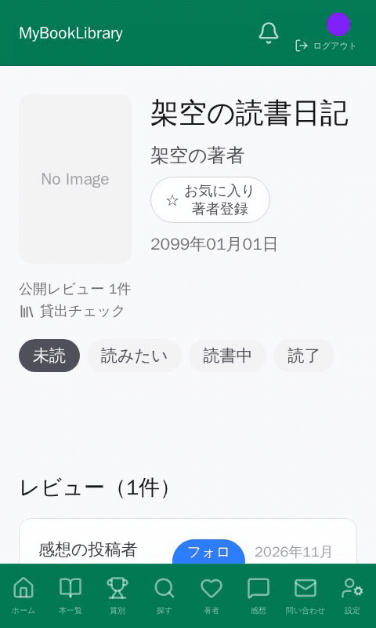
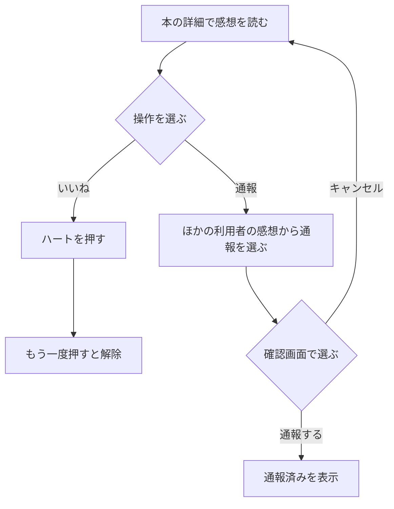

# いいね・通報 機能定義書

← [要件定義書に戻る](../requirements.md)

## 使い方

本の詳細で感想を読み、ハートを押すと「いいね」が付きます。不適切な感想を見つけた場合は、ほかの利用者の感想にある「通報」を選び、確認画面で「通報する」を押します。

## 実画面

外部通信を遮断したローカル環境で、説明用の架空の感想を使って撮影しました。

## 操作フローチャート

## 注意点

- 同じ感想へのいいねと通報は、それぞれ利用者1人につき1件です。
- 通報された感想は管理者が確認します。自分の感想のいいね数は「投稿した感想」から確認できます。

## 機能仕様

### 一般ユーザー・管理者（共通）

#### できること

- 感想にいいねを付けたり、付けたいいねをもう一度押して取り消したりする。
- ほかの利用者の公開感想を通報し、画面の「通報済み」表示で確認する。

#### できないこと・条件

- 通報のボタンはほかの利用者の感想に表示される。通報後に画面でできるのは状態の確認まで。

### 管理者（通報への対応）

#### できること

- 管理者パネルで通報された感想を確認し、内容に応じて削除する。[管理者機能](./admin.md)

## 設計判断・理由

いいねと通報は目的が異なるため別々に保存します。通報後の対応は、管理者が内容を確認して判断します。

技術詳細（保存・処理条件・関連画面／API）

### 動作条件と処理の仕組み

#### いいね

- ほかの利用者の感想にいいねを付けると、投稿者への通知を作成する。同じ宛先・本のいいね通知がある場合は重複作成しない。

#### 通報

- 通報時は利用者とレビューの組み合わせで通報を保存し、管理者に通知する。管理者パネルは通報記録のある感想を表示する。
- 通報を取り消す API は、操作した利用者の通報記録を削除する。通常の画面には通報後の取り消しボタンを表示しない。

### 関連画面

| パス | 画面名 |
| --- | --- |
| `/books/[id]` | 本の詳細（いいね・通報ボタン） |
| `/my-reviews` | マイレビュー（いいね数の確認） |

### 関連 API エンドポイント

| メソッド | パス | 説明 |
| --- | --- | --- |
| POST | `/api/reviews/[id]/likes` | いいね追加 |
| DELETE | `/api/reviews/[id]/likes` | いいね解除 |
| POST | `/api/reviews/[id]/report` | レビュー通報 |
| DELETE | `/api/reviews/[id]/report` | 通報取り消し |

### 関連ドキュメント

- [ER 図](../er-diagram.md) — Like・Report テーブル構成
- [通知機能定義書](./notifications.md) — いいね通知の生成
- [管理者機能定義書](./admin.md) — 通報レビューの管理・削除

