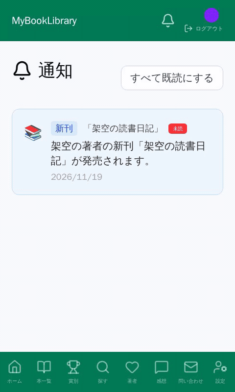
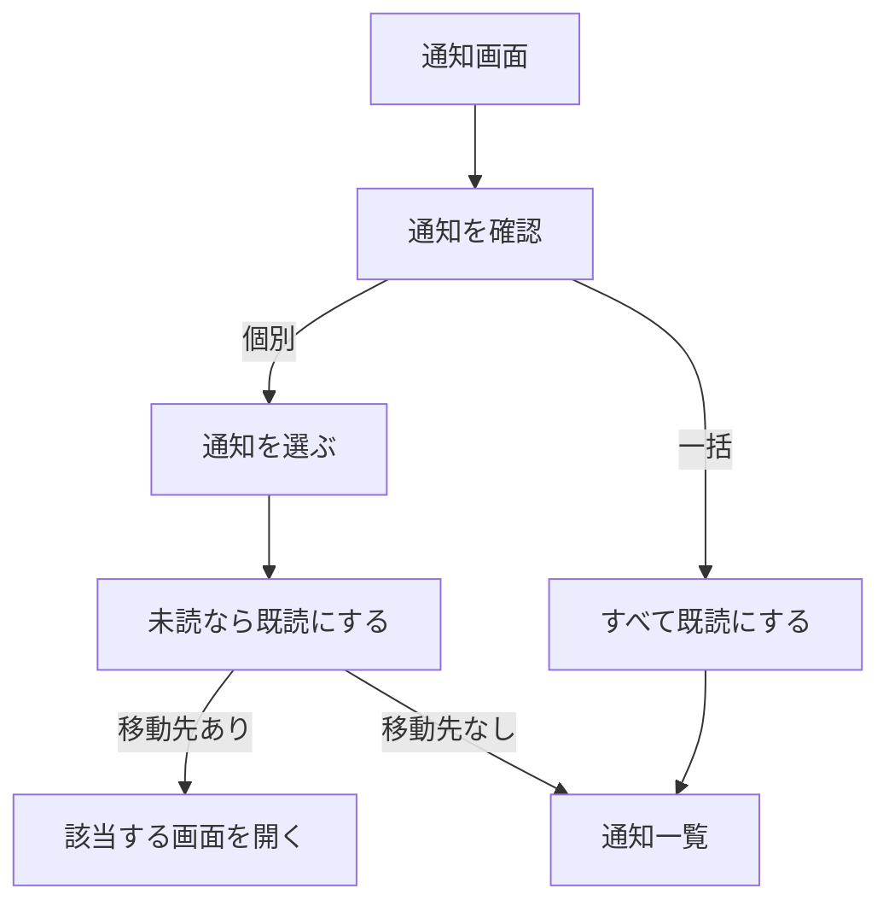

# 通知 機能定義書

← [要件定義書に戻る](../requirements.md)

## 使い方

1. 「通知」を開き、未読の通知を確認します。
2. 通知を選ぶと既読になります。移動先が設定されている場合は、本やユーザーの詳細画面などが開きます。
3. まとめて処理する場合は「すべて既読にする」を押します。

## 実画面

隔離したローカル環境で、事前に用意した架空の新刊通知を「すべて既読にする」で既読にする例です。個別通知からの移動や PWA のアイコン表示は収録範囲外です。

## 操作フローチャート

## 注意点

- 定期チェックでお気に入り著者の新刊が見つかると、新刊通知が届きます。
- インストールした PWA のアイコンに未読件数を出せるかどうかは、端末・ブラウザの対応状況によります。

## 機能仕様

### 一般ユーザー・管理者（共通）

#### できること

- 新刊や「いいね」などをアプリ内で確認し、個別またはまとめて既読にする。

#### できないこと・条件

- ログイン中のアカウントに届いた通知をアプリ内で確認できる。新刊通知は新刊通知をオンにした著者が対象。

### 管理者

#### できること

- レビューが通報されたときにアプリ内で通知を受け取る。

## 設計判断・理由

通知内容と既読状態を保存します。画面の未読件数や対応環境のPWAバッジは、その状態を表示します。

技術詳細（保存・処理条件・関連画面／API）

### 動作条件と処理の仕組み

#### 通知の種類

| 種類                                   | 発生タイミング                                             |
|----------------------------------------|------------------------------------------------------------|
| 新刊通知 | 新刊通知をオンにしたお気に入り著者の本が定期チェックで検出されたとき |
| いいね通知                             | 自分の感想にいいねが付いた際                               |
| フォロー通知                           | 他ユーザーにフォローされた際（フォローバックの提案を含む） |
| 相互フォロー活動通知（お気に入り著者） | 相互フォロー中の相手がお気に入り著者を追加した際           |
| 相互フォロー活動通知（読みたい本）     | 相互フォロー中の相手が読みたい本を追加した際               |
| レビュー通報 | レビューが通報されたときに管理者へ |
| レビュー削除 | 管理者がレビューを削除したときに投稿者へ |
| 合言葉の設定案内 | 合言葉未設定の利用者がパスワード再設定の確認を行ったときに本人へ。同種の通知がある場合は追加しない |
| 管理者によるパスワードリセット | 管理者がパスワードを強制リセットしたときに本人へ |

相互フォロー活動通知は、フォロー解除またはアカウント削除により相互フォロー関係が解消されると削除される（詳細は[フォロー機能 機能定義書](./follow.md)を参照）。

#### 既読管理

- 通知一覧の取得と既読更新の対象は本人に届いた通知。通知一覧を作成日時の新しい順に表示する。
- アプリの表示時に未読件数を確認し、既読操作に応じて未読件数を更新する。

#### PWA バッジ

- PWA インストール時はアプリアイコンに未読通知数をバッジ表示できる（Browser Badge API）

### 関連画面

| パス             | 画面名                             |
|------------------|------------------------------------|
| `/notifications` | 通知一覧（新刊・いいね・既読管理） |

### 関連 API エンドポイント

| メソッド | パス                           | 説明           |
|----------|--------------------------------|----------------|
| GET      | `/api/notifications`           | 通知一覧       |
| PATCH    | `/api/notifications/[id]/read` | 通知を既読化   |
| PATCH    | `/api/notifications/read-all`  | 全通知を既読化 |

### 関連ドキュメント

- [ER 図](../er-diagram.md) — Notification テーブル構成
- [新刊チェック（Cron）定義書](./cron.md) — 新刊通知の自動生成
- [いいね・通報定義書](./likes-reports.md) — いいね・通報通知のトリガー
- [認証・アカウント管理 機能定義書](./auth.md) — 合言葉とパスワードリセット

