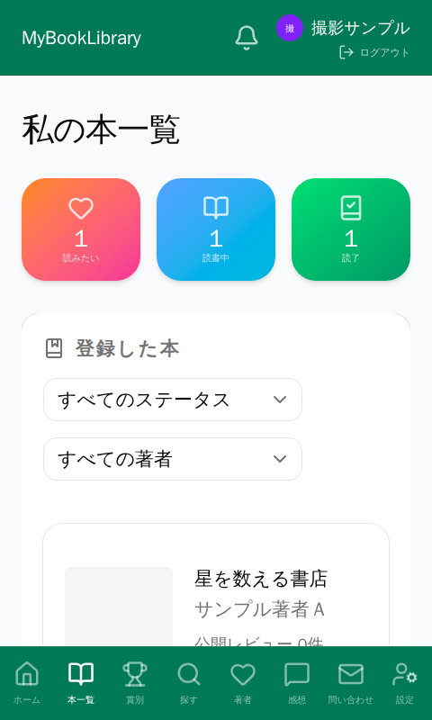
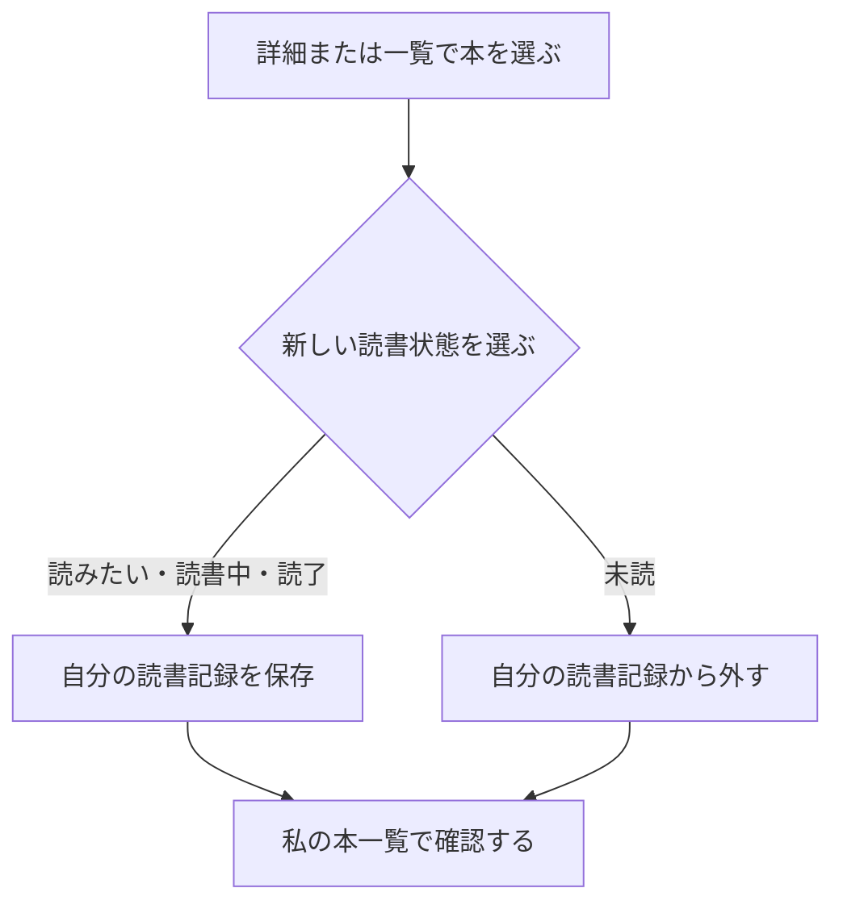

# 読書ステータス管理 機能定義書

← [要件定義書に戻る](../requirements.md)

## 使い方

本の詳細や一覧で「読みたい」「読書中」「読了」を選びます。「私の本一覧」で記録した本を絞り込めます。読書記録から外すときは「未読」を選びます。

## 実画面

本の詳細では、書誌情報の下に「未読」「読みたい」「読書中」「読了」のボタンが並びます。現在の状態は選択中のボタンで確認できます。賞別作品一覧、本の検索結果、著者別書籍一覧からも状態を変更できます。

外部通信を遮断したローカル環境で、架空の本と読書記録を使って撮影しました。

## 操作フローチャート

## 注意点

- 変更するのは自分の読書記録です。「未読」に戻した後も、本や投稿済みの感想は残ります。
- プロフィールには「未読」を除く読書記録が表示され、ログイン中のほかの利用者も閲覧できます。[フォロー機能](./follow.md)

## 機能仕様

### 一般ユーザー・管理者（共通）

#### できること

- 本ごとに「未読」「読みたい」「読書中」「読了」を選び、状態を何度でも変更する。

#### できないこと・条件

- 「私の本一覧」に表示されるのは、読書ステータスを記録した本です。

## 設計判断・理由

本の書誌情報と利用者ごとの読書ステータスを分けています。同じ本について、利用者ごとに自分の状態を記録できます。

技術詳細（保存・処理条件・関連画面／API）

### 動作条件と処理の仕組み

| ステータス値 | 表示名 |
| --- | --- |
| `unread` | 未読 |
| `want_to_read` | 読みたい |
| `reading` | 読書中 |
| `read` | 読了 |

- 利用者と本の組み合わせで状態を登録・更新する（upsert）。
- `unread` に戻すと、その組み合わせの `ReadingStatus` レコードを削除する。レコードがない場合の表示は「未読」。
- ステータス登録時、同じタイトル・著者の本が登録済みの場合は、版違いでも既存の本にひも付ける。

### 関連画面

| パス | 画面名 |
| --- | --- |
| `/books` | マイ本一覧（ステータス別フィルター） |
| `/books/[id]` | 本の詳細（ステータスボタン） |
| `/awards` | 受賞作品一覧（各作品にステータスボタン） |
| `/favorite-authors/[authorId]` | 著者別書籍一覧（各書籍にステータスボタン） |
| `/books/search` | 本の検索（検索結果にステータスボタン） |

### 関連 API エンドポイント

| メソッド | パス | 説明 |
| --- | --- | --- |
| POST | `/api/reading-status` | 読書ステータス登録・更新（upsert） |

### 関連ドキュメント

- [API 仕様書](../api-spec.md) — リクエスト/レスポンス形式・バリデーション
- [ER 図](../er-diagram.md) — ReadingStatus テーブル構成

