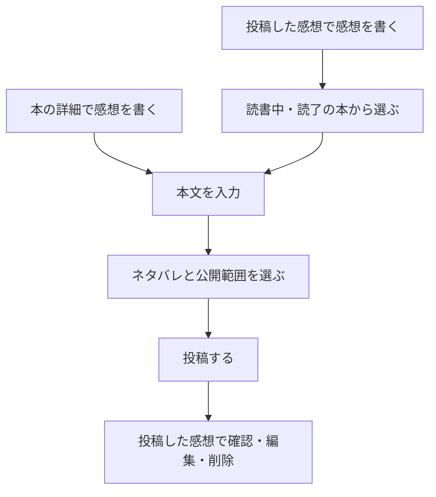

# 感想投稿・一覧 機能定義書

← [要件定義書に戻る](../requirements.md)

## 使い方

本の詳細にある「感想を書く」、または「投稿した感想」の「感想を書く」から始めます。本文を入力し、ネタバレの有無と公開範囲を確認して投稿します。投稿後の編集・削除は「投稿した感想」で行います。

## 実画面

外部通信を遮断したローカル環境で、架空の本に本人だけが閲覧できる感想を投稿した場面です。

## 操作フローチャート

## 注意点

- 本文は10〜2000文字です。投稿時の公開範囲は初期状態で「全体に公開する」が選ばれています。
- 自分だけが読める記録にするには、「全体に公開する」のチェックを外します。

## 機能仕様

### 一般ユーザー・管理者（共通）

#### できること

- 自分の感想を投稿、編集、削除する。公開範囲とネタバレの有無はそれぞれ設定できる。
- 本の詳細でほかの利用者の公開感想と自分の感想を読む。

#### できないこと・条件

- 非公開の感想は、通常の閲覧画面では投稿者本人だけに表示される。
- 「感想を書く」の対象は読書中または読了で未投稿の本。投稿済みの場合は「投稿した感想」で既存の感想を編集・削除する。

### 管理者（通報への対応）

#### できること

- 通報された感想を管理者パネルで確認し、内容に応じて削除する。[管理者機能](./admin.md)

## 設計判断・理由

公開範囲とネタバレの注意表示を別々に保存します。公開レビュー件数を集計するときは公開された感想を対象にし、本人が閲覧できる非公開の感想と区別します。

技術詳細（保存・処理条件・関連画面／API）

### 動作条件と処理の仕組み

- マイレビュー画面で自分の投稿一覧を確認できる（非公開感想には「非公開」バッジを表示）
- 本の詳細画面で全ユーザーの公開感想を閲覧できる（自分の非公開感想も表示）
- 本の詳細に「感想投稿済み」バッジを表示し、「投稿した感想」の本選択では投稿済みの本を選択対象から外す。保存時の検証には、同じ利用者・本の組み合わせごとの件数制限を設けていない。

#### 公開 / 非公開の仕様

| 設定 | 書籍詳細ページ | マイレビューページ |
| --- | --- | --- |
| 全体公開（`isPublic: true`） | 全ユーザーに表示 | 表示（バッジなし） |
| 非公開（`isPublic: false`） | 投稿者本人のみ表示 | 表示（「非公開」バッジあり） |

投稿・編集フォームには「全体に公開する」チェックボックスと「公開した感想は他のユーザーも閲覧できます」という注意書きを表示する。

#### バリデーション

| 項目 | ルール |
| --- | --- |
| 本文 | 10〜2000 文字 |
| ネタバレフラグ | true / false |
| 公開フラグ | true / false（デフォルト: true） |

### 関連画面

| パス | 画面名 |
| --- | --- |
| `/books/[id]` | 本の詳細（全ユーザーのレビュー一覧） |
| `/books/[id]/reviews/new` | レビュー作成 |
| `/my-reviews` | マイレビュー（自分の投稿一覧・編集・削除） |

### 関連 API エンドポイント

| メソッド | パス | 説明 |
| --- | --- | --- |
| GET | `/api/reviews` | 自分のレビュー一覧 |
| POST | `/api/reviews` | レビュー作成 |
| PATCH | `/api/reviews/[id]` | レビュー編集 |
| DELETE | `/api/reviews/[id]` | レビュー削除 |

### 本の公開レビュー件数

- 私の本一覧、本検索、著者別書籍一覧、受賞作品一覧、ユーザー詳細の本一覧、本詳細のヘッダー、レビュー投稿の本選択モーダルに「公開レビュー N件」を表示する。0件も表示する。ダッシュボードは対象外。
- `isPublic: true` のReviewレコードをBook単位で数える。同一ユーザーの複数投稿・公開のネタバレレビューも件数に含め、自分を含む非公開レビューは含めない。
- 複数ISBNは同じBookに紐づくため、代表外ISBNで検索した場合も同じ件数を表示する。曖昧な同名別著者・複数Bookの件数は混ぜない。未登録の外部検索結果は0件で、件数取得のための登録は行わない。
- 外部結果はBook ID・登録済みISBNを優先して照合する。ISBNで一致しない場合はタイトルと著者名の完全一致で一意に決まるBookだけを参照する。全角・半角・空白などの表記ゆれ補正は行わない。検索のたびに著者一覧や著者の全著作を取得しない。
- 投稿・削除・公開範囲変更後は画面の再読み込みまたは再取得で反映する。「感想投稿済み」は自分の投稿の有無を示す別の情報として維持する。
- 本詳細のレビュー一覧には従来どおり自分の非公開レビューも表示されるため、一覧の件数と公開レビュー件数が異なる場合がある。

### 関連ドキュメント

- [API 仕様書](../api-spec.md) — バリデーションルール・エラーコード
- [ER 図](../er-diagram.md) — Review テーブル構成
- [いいね・通報定義書](./likes-reports.md) — レビューへのいいね・通報

